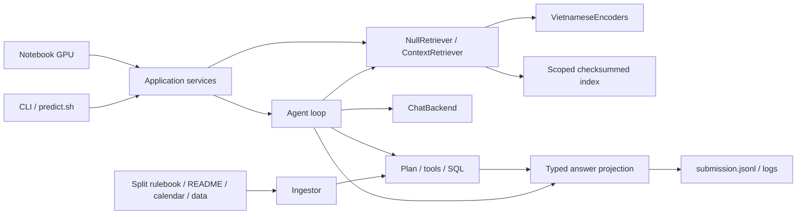

# Kiến trúc DataMate

Ứng dụng **modular monolith**: notebook GPU, CLI và Docker dùng cùng application/Agent loop. **Pipeline 6** chọn Transformers/vLLM độc lập với RAG; DemoBackend phục vụ kiểm thử CPU. Web và Qwen 4B đã bỏ khỏi phiên bản chính ngày 09/11/2026.

| Module | Trách nhiệm |
|---|---|
| domain.py, config.py | Question/Answer/RunResult, type và cấu hình |
| data/ | Ingest CSV/XLSX/SQLite, catalog, chuẩn hóa và SQL chỉ đọc |
| models/ | Registry pin revision, inventory ≤15B, stage/seal/verify artifact, backend |
| agent/ | Prompt, plan, tool loop, sửa lỗi và kiểm tra đáp án |
| retrieval/ | Encoder/reranker, corpus raw, index scope/cache và đóng context |
| application.py, cli.py, execution.py | Composition, batch, deadline, watchdog process, resume, output và log |
| evaluation/, training/ | Scoring và training/validation riêng |

Dữ liệu gốc chỉ đọc; cache/SQLite scratch ở ngoài dataset. Thời gian theo as_of_date và rulebook của split. Đáp án số được lấy từ kết quả công cụ, không để model tự sửa số sau query. ID chỉ dùng định tuyến/ghép/log.

## Quyết định tích hợp

Chốt **Adapter + Strategy**: adapter bọc thư viện engine/encoder; strategy chọn backend hoặc chế độ retrieval qua config; application lắp các thành phần qua interface.

- [Hải: vLLM](plans/plan-integrate-vllm-2026-11-09.md).
- [Thịnh: RAG](plans/plan-integrate-rag-2026-11-09.md).

Hai plan là đặc tả đã duyệt; bản ghép ngày 14/11 có `VLLMBackend`/`TransformersBackend` là adapter `ChatBackend`, `build_backend()` chọn strategy qua `Settings.backend`. `VietnameseEncoders` bọc embedding/reranker; `build_retriever()` chọn `NullRetriever` hoặc `ContextRetriever`, mode dense/dense_rerank quyết định bước chấm cặp. Tên class được gom để dùng chung batching/lifecycle, không tạo ba engine riêng. `create_agent()` chuẩn bị/inject các thành phần; question workers dùng chung engine/retriever và root Agent đóng chúng một lần.

Khi rag.none/rỗng/fallback, giữ prompt baseline; khi bật, thêm evidence có provenance với budget tokenizer generator. Không đổi planning/tools/projection để “hỗ trợ” RAG. SQL tính đầy đủ dòng thỏa điều kiện. Tham khảo [báo cáo hợp nhất](integration-vllm-rag-2026-11-14.md) và [cách chạy đối chứng](run-gpu.md).

Local chỉ edit/test CPU. Full-checkpoint inference trên Colab/Kaggle/GPU thuê; Docker cuối chạy offline với checkpoint đã đóng gói. Giữ local_files_only, manifest/hash và nguồn license dù chuyển nơi chạy.

Phân tích pipeline, benchmark và rollback cũ ở [history](history/); số đo cũ không phải baseline mới. [Ngữ cảnh cuộc thi](competition-context.md) phân biệt quy định được cung cấp và quyết định thiết kế.
