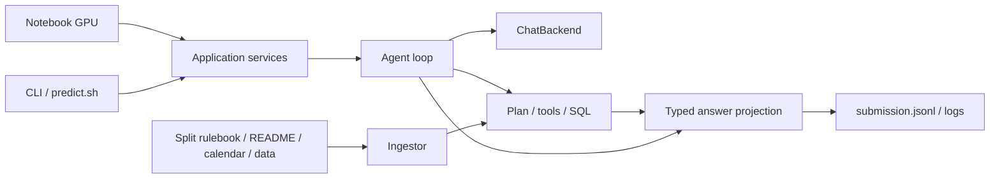

# Kiến trúc DataMate

Ứng dụng **modular monolith**: notebook GPU, CLI và Docker dùng cùng application/Agent loop. Runtime hiện tại giữ **pipeline 6** và backend Transformers; DemoBackend phục vụ kiểm thử CPU. Web và Qwen 4B đã bỏ khỏi phiên bản chính ngày 09/11/2026.

| Module | Trách nhiệm |
|---|---|
| domain.py, config.py | Question/Answer/RunResult, type và cấu hình |
| data/ | Ingest CSV/XLSX/SQLite, catalog, chuẩn hóa và SQL chỉ đọc |
| models/ | Registry pin revision, inventory ≤15B, stage/seal/verify artifact, backend |
| agent/ | Prompt, plan, tool loop, sửa lỗi và kiểm tra đáp án |
| application.py, cli.py | Batch, deadline, resume, output và log |
| evaluation/, training/ | Scoring và training/validation riêng |

Dữ liệu gốc chỉ đọc; cache/SQLite scratch ở ngoài dataset. Thời gian theo as_of_date và rulebook của split. Đáp án số được lấy từ kết quả công cụ, không để model tự sửa số sau query. ID chỉ dùng định tuyến/ghép/log.

## Quyết định tích hợp

Chốt **Adapter + Strategy**: adapter bọc thư viện engine/encoder; strategy chọn backend hoặc chế độ retrieval qua config; application lắp các thành phần qua interface.

- [Hải: vLLM](plans/plan-integrate-vllm-2026-11-09.md).
- [Thịnh: RAG](plans/plan-integrate-rag-2026-11-09.md).

Các interface bổ sung trong plan chưa được triển khai bởi đợt dọn bố cục. Khi rag.none, phải giữ hành vi baseline; khi dùng RAG, retrieval hỗ trợ tìm nguồn/nghĩa, SQL vẫn tính trên toàn bộ dòng thỏa điều kiện. Mỗi người tự chọn benchmark nhưng so trước/sau trên cùng tập của mình.

Local chỉ edit/test CPU. Full-checkpoint inference trên Colab/Kaggle/GPU thuê; Docker cuối chạy offline với checkpoint đã đóng gói. Giữ local_files_only, manifest/hash và nguồn license dù chuyển nơi chạy.

Phân tích pipeline, benchmark và rollback cũ ở [history](history/); số đo cũ không phải baseline mới. [Ngữ cảnh cuộc thi](competition-context.md) phân biệt quy định được cung cấp và quyết định thiết kế.
