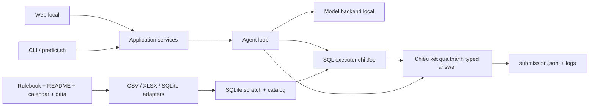

# Kiến trúc DataMate

Quyết định triển khai ngày **01/11/2026**, theo yêu cầu xây agent modular monolith. Đây là quyết định của dự án; không phải quy định kiến trúc từ ban tổ chức.

**Modular monolith** nghĩa là một ứng dụng Python có các module với trách nhiệm riêng, cùng chạy và cùng đóng gói. CLI, web và Docker dùng chung vòng lặp agent. Không cần LangChain, dịch vụ vector, máy chủ model hoặc hàng đợi riêng để chạy baseline này.



| Module | Trách nhiệm | Ranh giới |
|---|---|---|
| `domain.py` | Question, Answer, RunResult, kiểm tra type | Không phụ thuộc web/model/data engine |
| `config.py` | Cấu hình và chế độ offline | Không suy ra business rules |
| `data/` | Đọc split, ingest dữ liệu gốc, catalog, SQL/UDF | Không đọc answers khi inference |
| `models/` | Registry pin SHA, inventory, seal/verify artifact, generate | Chỉ `stage-model` được tải trọng số online |
| `agent/` | Prompt, tool loop, sửa SQL, tự kiểm tra | Không thực thi Python/shell do model sinh |
| `application.py` | Batch, resume, deadline, JSONL và log | Dùng chung với các interface |
| `evaluation/` | Local matching và so sánh trên cùng câu hỏi | Không thay thế bộ chấm chính thức |
| `training/` | Train-only allowlist, business holdout, LoRA, merge | Không sinh dữ liệu train từ test |
| `api.py`, `web/`, `cli.py` | HTTP/UI/CLI | Không chứa logic quyết định đáp án nghiệp vụ |

## Một câu hỏi được xử lý thế nào

1. `business_id` định tuyến tới đúng thư mục; `id` dùng để ghép đầu ra và log. Không có nhánh đáp án theo hai ID này.
2. Đọc rulebook của split, `calendar.csv`, README doanh nghiệp và catalog bảng. Lấy `as_of_date` từ câu hỏi; không dùng ngày hệ thống để giải nghĩa “hôm nay”.
3. Model xuất một action JSON: `schema`, `sql`, hoặc `final`. SQL lỗi được phản hồi để sửa trong ngân sách bước.
4. SQLite thực thi phép tính. `final` có giá trị được lấy **trực tiếp từ query cuối** theo `type`; model không được tự tính tiếp hoặc sửa số sau query.
5. Kiểm tra type/shape. Khi thiếu dữ liệu có căn cứ, model có thể kết luận `unanswerable`; chưa đủ chắc chắn, lỗi hoặc hết thời gian thì `abstain`.
6. Ghi đáp án và log từng câu, flush/fsync để giữ tiến độ khi dừng. `self_review` gọi lại cùng checkpoint trước khi chấp nhận đáp án.

Ví dụ giao thức:

```json
{"action":"sql","sql":"SELECT round_half_up(SUM(num_en(\"Thành tiền\")),0) AS doanh_thu FROM \"tên_bảng_trong_catalog\" WHERE ...","parameters":[]}
```

```json
{"action":"final","type":"number","from_query":true}
```

SQL phía trên minh họa giao thức, **không phải query đúng cho mọi doanh nghiệp**. Lọc trạng thái, join, xử lý trả hàng, quy đổi đơn vị và thời gian phải theo schema/rulebook thực tế. Model có thể chọn sai query dù SQL chạy thành công; cần đánh giá bằng nhãn train.

## Giữ nguyên dữ liệu gốc

- CSV UTF-8, toàn bộ sheet XLSX và các bảng SQLite được đưa vào SQLite scratch bên ngoài dataset. Excel giữ giá trị số là số, chuỗi là chuỗi. Ngày Excel thật chuyển sang ISO; chuỗi ngày gốc được giữ nguyên.
- Các ô trống, dòng trùng và trạng thái ở dòng đầu nhóm được giữ lại. Không tự ffill hay dedup toàn bộ dữ liệu. Query phải thực hiện những biến đổi đó theo khóa và rulebook.
- `_dm_file`, `_dm_sheet`, `_dm_row` lưu nguồn. Header trống/trùng được đặt tên duy nhất và ghi mapping.
- Header Excel có phần tiêu đề được phát hiện bằng heuristic, lưu số dòng header và cảnh báo. Heuristic không bảo đảm mọi file tương lai; lỗi đọc dẫn đến abstain, không tự bịa schema.
- Các sheet cùng file có cấu trúc giống nhau có view `__all` dùng `UNION ALL`. Không cộng view này với sheet thành phần lần nữa.
- Công thức Excel dùng giá trị cache; chưa hỗ trợ tự tính workbook. Ô công thức không có cache có thể là NULL và phải được kiểm tra.
- Fingerprint nguồn dùng SHA256 của file; cache nằm ở `.cache/datamate` trên E:. Không biến cache test thành nguồn training.

## SQL và thời gian chạy

Kết nối SQLite dùng `mode=ro`, `query_only`, authorizer chặn ghi/attach/pragma/load extension, progress handler giới hạn thời gian và số dòng/kích thước kết quả. Chỉ có các UDF đã đăng ký, không có Python eval/exec.

`num_en`, `num_vi`, `iso_date`, `iso_date_year`, `norm`, `round_half_up` là phép biến đổi **tường minh** trong query. `num` báo lỗi ở một số chuỗi mơ hồ như `1.234`, để model chọn locale theo nguồn. SQLite SUM vẫn dùng số nguyên/dấu phẩy động theo kiểu giá trị; UDF làm tròn Decimal không biến toàn bộ truy vấn thành tính toán Decimal chính xác tuyệt đối.

Batch tính wall time từ trước load model, gồm hash verification và ingestion. Có timeout từng câu, từng query, số bước và token. `predict.sh` có watchdog cứng dưới 6 giờ. Đây là giới hạn thực thi, chưa phải bằng chứng rằng model trả lời hết private test đúng và kịp 6 giờ.

## Model và khả năng mở rộng

Mặc định chưa tải trọng số. Backend Transformers dùng file local, `trust_remote_code=False`, `local_files_only=True`; Docker inference tắt mạng. Chưa thêm embedding/reranker để dành ngân sách tham số.

Có thể bổ sung semantic schema adapter hoặc công cụ tính toán khác bên trong module, rồi đo lại trên holdout. Chưa có luật doanh thu hay mapping cột cố định cho một business ID. Không có chiến lược abstain đã hiệu chỉnh xác suất, không có claim accuracy/benchmark.
