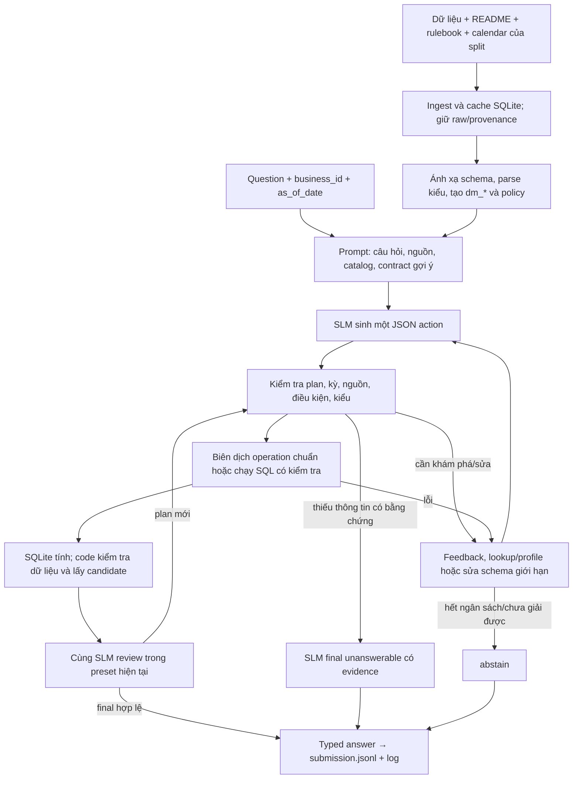

**DataMate — Phân tích hệ thống, pipeline và vai trò của SLM cho buổi thảo luận kỹ thuật**

Ngày phân tích: **08/11/2026**, múi giờ Asia/Saigon. Đây là tài liệu phân tích hiện trạng và đề xuất thảo luận; không thay đổi quyết định kiến trúc, checkpoint, cấu hình inference hoặc gói training của đội.

**Nhận định chính:** DataMate hiện dùng **SLM để chuyển câu hỏi thành kế hoạch có cấu trúc; Python điều phối và kiểm tra; SQLite thực hiện phép tính; code lấy kết quả thành đáp án đúng kiểu**. Hướng phát triển phù hợp với bằng chứng đang có là giảm lỗi ở các ranh giới này, chuyên biệt hóa SLM cho việc hiểu yêu cầu và sửa kế hoạch, rồi đo riêng từng tối ưu.

**1. Phạm vi và mức xác minh**

Đã đọc `AGENTS.md`, `README.md`, ngữ cảnh cuộc thi, tài liệu rollback, kiến trúc, training, các báo cáo inference liên quan và code đang hoạt động. Đã đọc rulebook TRAIN và README POS thực tế để đối chiếu cách giải thích dữ liệu. Roadmap ngày 02/11 là nguồn ý tưởng lịch sử; trạng thái triển khai được xác định lại từ code và cấu hình hiện tại.

| Nội dung | Kết quả xác minh trong phiên phân tích |
|---|---|
| Engine đang hoạt động | `Agent.pipeline_version = 6`; Transformers backend protocol 3 |
| Preset Qwen 9B và Gemma 12B | `self_review`, `code_first`, `adaptive_preparation=false`, bắt buộc plan, tự thực thi plan |
| Ngân sách hai preset | 6 bước, context 16.384 token, tối đa 768 token sinh/lượt, 90 giây/câu; sửa schema tối đa 20 giây/512 token trong ngân sách câu |
| Dữ liệu TRAIN có thật | 3.000 câu, 30 doanh nghiệp; 107 XLSX, 20 CSV, 1 SQLite và 30 README. Đây là số file, không phải số bảng |
| Bốn lượt benchmark được dùng bên dưới | Chấm lại submission đã lưu bằng local evaluator; cùng 100 ID và thứ tự; số đúng/sai/bỏ qua khớp summary |
| Training Gemma | Có bộ seed và quy trình QLoRA; báo cáo seed ghi chưa chạy GPU training |
| Đo lường mới | Không gọi SLM, không chạy GPU inference/fine-tune hoặc đo tốc độ mới |

Interface v7 **đã rollback**. Một số cách sửa projection, kiểu tham số, khóa và review được ghi trong tài liệu v7 chỉ còn là lịch sử, chưa có trên đường chạy v6 hiện tại. Không suy từ việc rollback rằng tốc độ hoặc PA đã được cải thiện. Xem [phạm vi rollback](<E:/Bảo Lập Trình AI/ZALO_AI_2026/docs/rollback-pipeline6-2026-11-08.md>).

Yêu cầu cuộc thi tiếp tục dựa trên [bản tổng hợp có ghi mức xác minh](<E:/Bảo Lập Trình AI/ZALO_AI_2026/docs/competition-context.md>). Phiên này không xác minh lại toàn bộ quy định chính thức hoặc lịch sử checkpoint trên Internet. Rulebook TRAIN được đọc trực tiếp chỉ xác nhận luật TRAIN.

Bằng chứng chấm lại và kiểm kê mới nằm ở [evidence.json](<E:/Bảo Lập Trình AI/ZALO_AI_2026/outputs/system-analysis-2026-11-08/evidence.json>).

**2. Pipeline là gì trong hệ thống này?**

Pipeline là chuỗi bước biến **câu hỏi + dữ liệu + luật** thành **đáp án có thể kiểm tra**. Model là một thành phần trong chuỗi đó. Chất lượng cuối phụ thuộc cả việc hiểu câu hỏi, đọc đúng dữ liệu, tính đúng và xuất đúng định dạng.

Có thể mô tả kiến trúc hiện tại là **agent phân tích dữ liệu có một model chính và các công cụ xác định**, triển khai dưới dạng **modular monolith**: một ứng dụng Python chia module, dùng chung cho CLI, web và Docker. Vòng lặp agent có giới hạn bước/thời gian; model được đọc lỗi công cụ và đề xuất action tiếp theo.

Các tên kỹ thuật dùng trong buổi họp:

| Thuật ngữ | Ý nghĩa tại DataMate |
|---|---|
| Text-to-plan | Chuyển tiếng Việt thành JSON mô tả đại lượng, phép toán, phạm vi, kỳ, điều kiện và kiểu đáp án |
| Schema linking | Nối ý nghĩa như thành tiền, số lượng, ngày thu với bảng/cột thực tế |
| Value grounding | Nối tên hàng/khách/nhóm trong câu hỏi với giá trị hoặc khóa có thật |
| Semantic layer | Các bảng `dm_*`, policy, profile và thông tin chất lượng giúp nhiều schema nguồn có giao diện chung |
| Tool use | Model yêu cầu `lookup`, `profile`, `sql`, `check`… rồi nhận kết quả hoặc lỗi |
| Guarded execution | Code kiểm tra điều kiện trước/sau tính, giới hạn SQL và ngân sách |
| Self-review | Gọi lại chính checkpoint để đối chiếu plan/kết quả với câu hỏi |
| SFT | Huấn luyện có giám sát bằng ví dụ đầu vào → action đúng |

SLM được dùng theo vai trò **bộ diễn giải ý định có thể học**. Python giữ quyền điều phối, xác thực và xuất đáp án; SQLite giữ trách nhiệm tính trên dữ liệu đầy đủ. Retrieval hiện có qua catalog, profile và lookup. Vector database, embedding/reranker và router học máy chưa có trong pipeline mặc định.

**3. Pipeline inference hiện tại**



Sơ đồ biểu diễn các luồng chính; `unanswerable` trong v6 vẫn có thể bị yêu cầu thêm lượt review. Nếu chạm bước cuối, hành vi đó có thể làm mất một kết luận có bằng chứng, như đã quan sát trong log.

| Bước | Công việc đang thực hiện | Vai trò của SLM |
|---|---|---|
| Load và kiểm kê | Xác minh model artifact, dùng checkpoint/tokenizer local, đọc split và đặt deadline | Chưa sinh đáp án |
| Ingest theo doanh nghiệp | CSV/XLSX/SQLite → scratch SQLite ngoài dataset, fingerprint nguồn, metadata và provenance | Mặc định không gọi |
| Chuẩn hóa | Đọc header/README/giá trị; parse số/ngày/trạng thái/đơn vị; tạo facts và policy | Code làm trước; có sửa bổ sung giới hạn khi cần |
| Tạo context câu hỏi | Đưa rulebook/README, schema, capability, coverage, `as_of_date` và gợi ý contract vào prompt | Đọc context để chọn action |
| Lập plan | Chọn measure, operation, population, periods, filters, type và tham số liên quan | Trách nhiệm chính |
| Tính toán | Plan chuẩn được biên dịch; nghiệp vụ custom dùng SQL; kiểm tra source/kiểu/chất lượng | Có thể sinh SQL hoặc khám phá thêm |
| Review và sửa | Đọc candidate/checklist, chốt hoặc lập lại plan | Cùng một model, trong ngân sách |
| Xuất và ghi tiến độ | Chiếu query result theo type, ghi JSONL và log, flush/fsync, hỗ trợ resume có identity | Không tự sửa số đã tính |

Cache semantic được dựng từ nguồn dữ liệu, không phụ thuộc đáp án câu hỏi. Dữ liệu có thể chứa nhiều thời điểm; mỗi truy vấn áp dụng thời gian và ngoại lệ theo `as_of_date`/rulebook. Vì thế không được cắt toàn bộ dữ liệu sau một ngày theo một luật chung lúc ingest.

Các lớp dữ liệu có trách nhiệm khác nhau:

- **Raw** giữ dữ liệu nguồn, header mapping và vị trí file/sheet/dòng.
- **`clean_*`** giữ dữ liệu đã parse cùng thông tin lỗi/ánh xạ.
- **`dm_sales_all`, `dm_orders_all`** giữ các trạng thái; `dm_sales`, `dm_orders` là view theo policy bán hàng hiện tại.
- **Danh mục và sổ** như `dm_products`, `dm_customers`, `dm_payments`, `dm_stock_ledger`, `dm_inventory` phục vụ entity, nợ và tồn.
- **Metadata** ghi capability, coverage, profile, các điểm mơ hồ và nguồn quyết định.

Mỗi dòng bán và mỗi đơn có cấp dữ liệu khác nhau. Đếm dòng bán không thay cho đếm đơn; snapshot tồn không được cộng như dòng nhập/xuất; tiền thu sau ngày bán không thay cho doanh thu theo ngày đặt. Semantic layer có ích khi nó bảo toàn được các khác biệt này.

**4. Ví dụ đi qua pipeline**

Với câu minh họa “Tỷ lệ đơn hủy tháng này”, một plan theo giao thức đang có là:

```json
{
  "action": "plan",
  "measure": "orders",
  "operation": "ratio",
  "type": "percent",
  "population": "all",
  "source": "dm_orders_all",
  "evidence_id": "Q",
  "periods": [{"kind": "this_month"}],
  "filters": [],
  "numerator_filters": [
    {"column": "status", "op": "eq", "value": "cancelled", "evidence_id": "Q"}
  ]
}
```

Trong rulebook TRAIN đã đọc, tử số là số đơn hủy; mẫu số là mọi đơn đặt trong kỳ, gồm mọi trạng thái. Code giải `this_month` từ ngày đầu tháng đến `as_of_date`, tính trên nguồn đủ trạng thái và làm tròn theo policy. Đây là minh họa cấu trúc, không phải kết quả đã chạy cho một câu cụ thể hoặc công thức mặc định cho mọi split.

Nếu plan chọn `population=sales`, đơn hủy đã bị loại. SQL vẫn có thể trả một số hợp lệ. Ví dụ này cho thấy hai điều cần được kiểm tra riêng: **phép tính có thực thi đúng plan không**, và **plan có diễn đạt đúng câu hỏi/luật không**.

**5. Các kỹ thuật tối ưu đã có và giới hạn**

| Kỹ thuật đang có | Lợi ích dự định | Giới hạn cần biết |
|---|---|---|
| Code-first preparation | Giảm lượt SLM mô tả toàn bộ doanh nghiệp/rulebook | Heuristic có thể không hiểu schema hoặc cách diễn đạt mới |
| Semantic layer chung | Giảm số schema mà planner phải trực tiếp xử lý | Mapping sai sẽ ảnh hưởng nhiều câu; phải giữ raw và provenance |
| Plan JSON và thư viện operation | Giảm lượng SQL model phải viết; giữ kỳ, ngưỡng, đơn vị có cấu trúc | JSON hợp lệ vẫn có thể sai nghĩa; API hiện khá nhiều trường |
| Auto-execute plan | Bỏ lượt gọi model chỉ để yêu cầu công cụ tính | Preset self-review vẫn cần lượt đọc lại kết quả |
| Lookup và profile | Ground tên/khóa/thuộc tính vào dữ liệu thật | Mẫu ba dòng không chứng minh phân bố hoặc tính duy nhất |
| Cache nguồn/semantic/sửa schema | Tái sử dụng chuẩn bị; tránh lặp một lỗi mapping đã biết | Chi phí cold start vẫn phải tính; cache gắn với nguồn và phiên bản |
| SQL chỉ đọc và kiểm tra | Chặn ghi/attach/extension, timeout, giới hạn kết quả, giữ lineage | SQL custom được kiểm tra cấu trúc, chưa được chứng minh ngữ nghĩa đầy đủ |
| Kiểm tra type và projection bằng code | Giảm lỗi chép số, sai JSON và shape | v6 còn lỗi final.columns; validation không phải bảo đảm hiểu đúng câu hỏi |
| EOS đúng, greedy, tắt thinking | Tránh sinh hội thoại giả và kiểm soát output | Không tự cải thiện lựa chọn đại lượng/thực thể/kỳ |
| Retry và deadline giới hạn | Chặn vòng lặp không tiến triển | Dừng đúng hạn có thể vẫn bỏ qua nhiều câu |
| Resume có hash/identity và log | Tái lập, giữ tiến độ, chẩn đoán lỗi | Không thay thế benchmark end-to-end |

Backend hiện có `use_cache=True` trong mỗi `generate`, dùng SDPA và serialize generation bằng lock. Code hiện không truyền cache trạng thái giữa các lần generate, chưa có prefix caching dùng chung giữa câu hỏi, chưa có scheduler batch inference. Bật KV cache khi sinh token và tái sử dụng prefix giữa request là hai mức tối ưu khác nhau; xem [tài liệu cache của Transformers](https://huggingface.co/docs/transformers/main/kv_cache).

**6. Kết quả hiện có nói gì?**

Đã chấm lại bốn submission sau trên cùng 100 câu TRAIN. Thời gian là số đã ghi trong bundle, **không gồm load model**; phiên phân tích này không đo lại thời gian.

| Lượt chạy đã lưu | Đúng | Sai | Bỏ qua | PA | Giây/câu | Calls/100 câu |
|---|---:|---:|---:|---:|---:|---:|
| Gemma baseline v3 | 49 | 13 | 38 | 0,36 | 18,26 | 351 |
| Gemma fast v5 | 46 | 16 | 38 | 0,30 | 23,19 | 256 |
| Qwen pipeline 5 | 49 | 32 | 19 | 0,17 | 9,64 | 194 |
| Qwen pipeline 6 | 43 | 20 | 37 | 0,23 | 10,68 | 311 |

`PA = (đúng − sai) / tổng số câu`. Qwen v6 tăng PA so với v5 nhờ giảm số sai, đồng thời số đúng giảm và bỏ qua tăng. Gemma fast v5 có ít calls hơn v3 nhưng chậm hơn; số token đầu ra ghi nhận tăng từ 18.791 lên 32.769. Vì vậy cần đo cả context, output và đường thực thi, không dùng số calls hoặc tên phiên bản để kết luận tốc độ.

Đây là mẫu TRAIN đã dùng chẩn đoán nhiều lần, không phải holdout độc lập. Các lượt khác prompt/tools/control; Qwen v5/v6 còn khác phiên bản Torch/Transformers. Chưa đủ bằng chứng chọn “model tốt nhất” bằng phép so chỉ thay model. Chưa có kết quả Gemma chạy cùng pipeline 6 trong bốn bundle này.

**7. Ba nhóm điểm nghẽn nổi bật**

**Giao diện công cụ đang làm mất kết quả.** Báo cáo Qwen v6 ghi 31 câu gặp lỗi projection, 21 câu không phục hồi và bỏ qua. Trong 21 câu đó, 15 candidate đã đúng, sáu candidate sai. Model thường nhét giá trị như `8.25` vào `columns`, hoặc phải chép tên cột là một biểu thức SQL rất dài. Đây là trách nhiệm thiết kế giao tiếp cần xử lý bằng code/API. Sửa cơ học có thể mở cả đáp án sai; không được cộng riêng 15 ca đúng để tuyên bố PA sau sửa.

**Plan hợp lệ chưa đồng nghĩa hiểu đúng tiếng Việt.** Trong 20 câu sai của lượt Qwen v6, phân nhóm nguyên nhân chính là: bảy sai đại lượng/phép toán/cấp tổng hợp/đầu ra; sáu sai ca/kỳ/năm; bốn thiếu hoặc sai thực thể/nhóm/thuộc tính; ba sai kiểu tham số hoặc dùng tên thay khóa. Ví dụ hỏi lãi gộp lại cộng doanh thu; hỏi số đĩa lại cộng tiền; hỏi đếm đơn đạt ngưỡng nhưng bỏ ngưỡng; dùng giờ ca để so trực tiếp với timestamp đầy đủ.

**Review và retry đang tiêu tốn compute mà chưa thể hiện lợi ích ngữ nghĩa trong lượt này.** Sau 84 candidate tính toán, mọi action tiếp theo quan sát được đều là final; không có plan sửa hoặc phép kiểm tra độc lập sau candidate. Đây là bằng chứng về hành vi của lượt chạy, chưa phải thí nghiệm chứng minh mọi self-review vô ích. Tổng input token Qwen v5→v6 tăng khoảng 2,057 triệu→3,287 triệu, calls 194→311. Cần đo riêng thời gian prefill và decode trước khi khẳng định thành phần nào chiếm ưu thế.

Nguồn chi tiết: [chẩn đoán Qwen pipeline 6](<E:/Bảo Lập Trình AI/ZALO_AI_2026/docs/inference-review-qwen9b-pipeline6-2026-11-07.md>) và [so sánh Gemma fast v5](<E:/Bảo Lập Trình AI/ZALO_AI_2026/docs/inference-review-fast-v5-2026-11-06.md>).

**8. Hướng tối ưu đề xuất, theo thứ tự thử nghiệm**

Các mục dưới đây là đề xuất cho đội lựa chọn; không được bật hoặc triển khai trong phiên này. Các sửa từng có ở v7 cần được tách thành thay đổi nhỏ và đo lại nếu đội muốn thử lại.

| Ưu tiên | Thay đổi cụ thể | Đo để quyết định |
|---|---|---|
| 1. Ổn định ranh giới executor → final | Alias native ổn định; code giữ type/projection đã kiểm tra; review chấp nhận result reference hoặc sửa plan, giảm thao tác chép cột | Projection errors, lost-correct candidates, wrong được mở ra, PA và latency |
| 2. Kiểm tra kiểu và entity trước số 0 | Bind bool/number theo schema; ID vẫn là ID; kiểm tra khóa tồn tại ở mọi nhánh, gồm ledger | Sai số 0, lookup mismatch, phân biệt không phát sinh với không tìm đúng đối tượng |
| 3. Kiểm tra mức đầy đủ của ý định | Plan nêu đại lượng, grain, kỳ/mốc so, phạm vi mẫu số, phủ định, thực thể, đơn vị, top-k và type; gắn chi tiết với đoạn câu hỏi/nguồn | Độ đúng từng thành phần và đáp án cuối; không chỉ schema-valid rate |
| 4. Review theo tín hiệu cần thiết | So always-review, single và review chọn lọc; reviewer phải tìm chi tiết thiếu/sai và có đường revise | Wrong→correct, correct→wrong, abstain, số calls, p50/p95 và wall time |
| 5. Giảm xử lý lặp context | Tách prefix ổn định khỏi request; cache theo model/tokenizer/policy/schema; chọn thông tin khám phá phù hợp | TTFT/prefill, tokens, cache hit, PA và tổng thời gian |
| 6. SFT SLM trên contract đã ổn định | Tập trung intent/plan/grounding/repair từ TRAIN được kiểm chứng | Base vs fine-tuned cùng pipeline; generation PA, lỗi ngữ nghĩa, token/calls |
| 7. Tối ưu runtime | Thử batch, prefix cache, quantization, speculative hoặc backend khác từng mục | Cold/warm wall time, VRAM, throughput, PA và khả năng chạy offline |

Không dùng regex để tự đổi mọi plan sang một đáp án “đúng theo từ khóa”. Mục tiêu của contract là làm rõ thiếu/mâu thuẫn, đưa phản hồi cụ thể và giữ SLM chịu trách nhiệm diễn giải. `evidence_id=Q` hiện chỉ xác định nguồn câu hỏi, chưa chứng minh từng filter thật sự diễn đạt đúng nguồn.

Với nghiệp vụ ngoài operation hiện có, ưu tiên phép dùng chung có thể kiểm thử: tổng hợp theo tháng rồi argmax, anti-join mặt hàng không bán, số dư tại thời điểm, hoặc tái dựng tồn theo lô khi có đủ dữ liệu và định nghĩa. Các trường hợp chưa biểu diễn được vẫn cần SQL có bằng chứng hoặc abstain; không bổ sung recipe theo question/business ID.

Prefix caching chỉ tái sử dụng được phần đầu giống nhau. Payload hiện đưa request trước rulebook/README/catalog, nên một phương án thử là đưa phần ổn định lên trước câu hỏi và nhóm lịch chạy theo doanh nghiệp, vẫn ghép đầu ra bằng ID. [Tài liệu vLLM](https://docs.vllm.ai/en/latest/features/automatic_prefix_caching/) mô tả khả năng giảm prefill, không giảm decode; hiệu quả tại DataMate phải đo. Khả năng hỗ trợ đúng checkpoint, cache trạng thái của kiến trúc model và stack offline là điều kiện trước khi đổi backend.

Grammar/JSON-schema constrained decoding có thể giảm action sai cú pháp hoặc enum. Nó không chứng minh filter, đại lượng hoặc kỳ đúng nghĩa. Backend Transformers hiện tại chưa có cơ chế này; [vLLM có tính năng structured outputs](https://docs.vllm.ai/en/latest/features/structured_outputs/) để tham khảo cho một thí nghiệm tương thích, không phải bằng chứng đã tích hợp.

**9. Cụ thể nên làm gì với SLM?**

Nên chuyên biệt hóa SLM cho các quyết định mà code khó suy ra trực tiếp từ tiếng Việt:

1. Phân biệt doanh thu, tiền thu, lãi gộp, số lượng, số đơn, số dư và dòng tiền.
2. Giữ đúng cấp tính: dòng hàng, đơn, ngày, tháng, sản phẩm hoặc khách.
3. Chọn kỳ tương đối theo `as_of_date`, kỳ so sánh và ca giờ; phát hiện câu hỏi có nhiều kết quả.
4. Nối entity/nhóm/đơn vị với schema và giá trị có thật, giữ phủ định và phạm vi mẫu số.
5. Chọn công cụ/phép tính phù hợp; sinh SQL khi cần; sửa đúng nguyên nhân lỗi mà vẫn giữ yêu cầu gốc.
6. Dựa vào bằng chứng công cụ để chọn unanswerable hoặc abstain đúng nghĩa.

Các tác vụ đã có định nghĩa xác định như cộng/đếm, giải lịch, quy đổi có hệ số, làm tròn, serialize JSON và kiểm tra khóa nên tiếp tục nằm trong code. Điều này giảm độ dài output SLM và số cơ hội tạo lỗi.

Trạng thái training hiện có cần được diễn đạt chính xác:

- Đã chuẩn bị **136 câu / 144 quyết định assistant** cho Gemma: 136 plan và tám final unanswerable có bằng chứng.
- Có 17 câu trong hàng chờ; 18 seed validation giữ ngoài train; tập validation theo doanh nghiệp gồm 630 câu.
- Bộ này là ví dụ được biên tập và chạy kiểm chứng bằng công cụ; không phải 136 trajectory mới do Gemma tự sinh.
- Report của bộ seed ghi **không có GPU training**. Chưa có PA sau fine-tune được cung cấp trong các artifact đã kiểm tra.
- Release khóa `target_pipeline_version=4` của fast v5. Pipeline 6 có prompt/schema/operation/review khác; cần release dữ liệu mới sau replay/curate, không thay source trong ZIP frozen.
- Các câu validation đã có tiếp xúc trong quá trình phát triển; cần ghi rõ mức độc lập khi đánh giá.

Recipe hợp lý để thử: giữ base checkpoint đã pin, SFT action đúng với loss trên assistant output; bổ sung ví dụ sửa lỗi có feedback, cùng các cặp phân biệt gần nhau như tiền/số lượng, tháng trọn/tháng tới hôm nay, giá trị dòng/tổng đơn và numerator/denominator. Paraphrase có dấu/không dấu/viết tắt phải ở cùng partition với câu gốc. Mọi phép sửa số/ngày/thực thể trong dữ liệu tổng hợp phải có lời giải thực thi lại, tránh học theo một nhãn cuối tình cờ trùng.

LoRA học các ma trận cập nhật nhỏ trên base được giữ cố định; QLoRA kết hợp base nén 4bit khi học adapter để giảm nhu cầu bộ nhớ. Đây là cách huấn luyện tiết kiệm tài nguyên, không tự bảo đảm agent tốt hơn. Có thể merge LoRA vào base sau training; chọn dtype inference và đo chất lượng riêng. Nguồn phương pháp: [PEFT LoRA](https://huggingface.co/docs/peft/main/en/conceptual_guides/lora), [bài QLoRA](https://arxiv.org/abs/2305.14314).

Không dùng loss training giảm làm tiêu chí thắng. Tiêu chí là **đáp án generation cuối cùng** trên dữ liệu evaluation được tách phù hợp, với cùng tools và ngân sách. Chi tiết release: [Gemma seed 72+100](<E:/Bảo Lập Trình AI/ZALO_AI_2026/docs/gemma-seed72-100-colab-pro.md>).

**10. Cách đánh giá để tránh tối ưu nhầm**

Nên có ba lớp kiểm tra có mục đích riêng:

| Lớp | Đầu vào | Điều được xác nhận |
|---|---|---|
| Tool/software regression | Plan/SQL được cấp trước, dữ liệu có kết quả đối chứng | Executor, projection, kiểu tham số, biên thời gian, join và guard hoạt động đúng trong ca kiểm tra |
| Model end-to-end | Câu hỏi gốc, dữ liệu và luật; SLM tự tạo action | Năng lực toàn pipeline, PA, coverage, lỗi và chi phí thực |
| Docker cold start | Image đã đóng gói, mạng tắt, input chỉ đọc | Load, artifact, phụ thuộc, ingest, inference và ghi output trong ngân sách thực |

Replay raw log và plan sửa tay rất hữu ích để định vị lỗi; không thay thế lượt model sinh action mới khi prompt/feedback đã thay đổi. 225 test đạt sau rollback được ghi trong tài liệu lịch sử; phiên phân tích này không chạy lại suite và không dùng số test để suy ra PA.

Các chỉ số nên đưa lên cùng một bảng: PA; đúng/sai/abstain/unanswerable; coverage và độ đúng trong câu đã trả lời; lỗi parse/plan/SQL/projection; candidate đúng bị mất; số lượt review thật sự revise; calls/token; load, ingest, generation, p50/p95, VRAM và tổng wall time. Báo theo doanh nghiệp, loại câu và schema/ngành khi có metadata xác minh.

So sánh backbone cần chạy Qwen và Gemma trên **cùng pipeline, question set, prompt contract, GPU, dtype và trần ngân sách**, ghi phiên bản thư viện. So sánh một tối ưu cần giữ các yếu tố khác cố định hoặc ghi rõ yếu tố cùng thay đổi. Benchmark team200 là mẫu TRAIN dùng chung, không phải independent holdout; kết quả fine-tune phải được đọc cùng phạm vi trùng lặp dữ liệu.

Với điểm +1/−1/0, nếu có xác suất đúng đã hiệu chỉnh là p thì kỳ vọng trả lời là `2p − 1`; ngưỡng lý thuyết là p > 0,5 khi bỏ qua chi phí thời gian và các yếu tố khác. Độ tự tin do SLM tự nói chưa phải xác suất đã hiệu chỉnh. Hiện hệ thống chưa có policy abstain được calibration; chỉ nên điều chỉnh bằng dữ liệu development tách phù hợp.

`unanswerable` cần chứng minh thông tin cần thiết không có; `unsupported` nghĩa là hệ thống chưa đọc/tính được; query không có hàng có thể là không phát sinh hoặc chọn sai điều kiện. Ba trạng thái này không được nhập làm một.

**11. Model, tài nguyên và triển khai**

Theo registry/evidence đang lưu trong dự án, Qwen 9B có khoảng **9,653B** tham số, Gemma 12B khoảng **11,960B**, Gemma + MTP assistant khoảng **12,383B**. Qwen + Gemma tổng khoảng **21,613B**, vượt trần 15B trong ngữ cảnh cuộc thi. Các số này tính toàn checkpoint đang khai báo, gồm phần đa phương thức; không lấy riêng phần tham số được kích hoạt khi dùng text.

Gọi lại cùng checkpoint để review không cộng thêm một model vào số tham số. MTP assistant là model phụ đề xuất token cho target kiểm chứng; mục tiêu là decoding, khác trách nhiệm review nghiệp vụ. Hiệu quả assistant tại dự án chưa được benchmark. Nén 4bit giúp giảm bộ nhớ trọng số, không giảm tham số được tính hoặc bảo đảm tăng tốc/chất lượng.

Registry đã pin revision, evidence trọng số trước 01/10/2026 và license. Trước khi thay model cần kiểm tra lại checkpoint cụ thể, ngày công khai trọng số, revision và mọi model phụ. Xem [kiểm kê và nguồn model](<E:/Bảo Lập Trình AI/ZALO_AI_2026/docs/model-comparison.md>).

Ngân sách phải đo theo:

```text
Tổng wall time = import + verify/load model + ingest/normalize/index
                + tổng thời gian xử lý các câu + ghi output/log.
```

Ví dụ lập ngân sách: nếu đúng 500 câu và không tính bất kỳ chi phí chung nào thì 6 giờ tương ứng 43,2 giây/câu. Đây chỉ là phép chia, không phải quota thực hay dự báo private; khi có load/ingest và biên an toàn, ngân sách khả dụng mỗi câu thấp hơn. Số câu/hardware/base image phải đối chiếu hướng dẫn chính thức.

Batch hiện chạy tuần tự, deadline mặc định 21.000 giây; `predict.sh` có watchdog ngoài dưới sáu giờ. Chưa có bằng chứng một image thi đầy đủ với model đã chạy hết private đúng hạn. Docker dev smoke và timer từ Colab không xác nhận điều đó. Output phải ở `/result/submission.jsonl`, log ở `/result/logs/`, `/data` chỉ đọc, cache/scratch ở vùng ghi và inference hoàn toàn offline.

**12. Các quyết định nên chốt trong buổi họp**

1. **Mốc tham chiếu:** đóng băng pipeline 6, source hash, config, model revision và bộ câu hỏi trước khi thử thay đổi; giữ log cũ.
2. **Ranh giới trách nhiệm:** SLM diễn giải/lập plan/sửa lỗi; code kiểm tra và tính; result reference là giao tiếp giữa executor và final.
3. **Thứ tự chất lượng:** sửa giao diện và kiểu/khóa, rồi đo semantic planner; mỗi thay đổi có ca phân biệt đúng/sai và báo regression.
4. **Review:** chọn cấu hình sau ablation, dựa vào số lỗi thực sự sửa được và chi phí, thay vì chỉ thêm một vai reviewer.
5. **Training:** ổn định API trước release seed mới; thử Gemma SFT trên dữ liệu được kiểm chứng và đánh giá generation, giữ gói frozen hiện tại.
6. **Tốc độ:** đo cold start/prefill/decode/CPU riêng; chọn cache, batching, quantization hoặc speculative theo phần thời gian chi phối.
7. **Cổng bàn giao:** PA cùng tập evaluation, số sai/lost-correct, tổng wall time và Docker offline; không tuyên bố cải thiện khi chỉ có CPU replay hoặc software tests.

**Các điểm đọc code để trao đổi trực tiếp**

| Chủ đề | Điểm bắt đầu |
|---|---|
| Controller, budget, review, auto-execute | [runner.py](<E:/Bảo Lập Trình AI/ZALO_AI_2026/src/datamate/agent/runner.py:24>) |
| Plan DSL, validation, compiler và SQL checks | [planning.py](<E:/Bảo Lập Trình AI/ZALO_AI_2026/src/datamate/agent/planning.py:63>) |
| Dữ liệu và policy chung | [normalization.py](<E:/Bảo Lập Trình AI/ZALO_AI_2026/src/datamate/data/normalization.py:115>) |
| Ingest và fingerprint | [ingest.py](<E:/Bảo Lập Trình AI/ZALO_AI_2026/src/datamate/data/ingest.py:106>) |
| Prompt và context | [prompts.py](<E:/Bảo Lập Trình AI/ZALO_AI_2026/src/datamate/agent/prompts.py:81>) |
| Sửa schema giới hạn | [schema_repair.py](<E:/Bảo Lập Trình AI/ZALO_AI_2026/src/datamate/agent/schema_repair.py:82>) |
| Chiếu kết quả theo type | [protocol.py](<E:/Bảo Lập Trình AI/ZALO_AI_2026/src/datamate/agent/protocol.py:86>) |
| Generation, EOS, cache và model local | [backends.py](<E:/Bảo Lập Trình AI/ZALO_AI_2026/src/datamate/models/backends.py:90>) |
| Batch, resume và wall clock | [application.py](<E:/Bảo Lập Trình AI/ZALO_AI_2026/src/datamate/application.py:29>) |
| Assistant-only SFT, LoRA/QLoRA và merge | [finetune.py](<E:/Bảo Lập Trình AI/ZALO_AI_2026/src/datamate/training/finetune.py:14>) |
