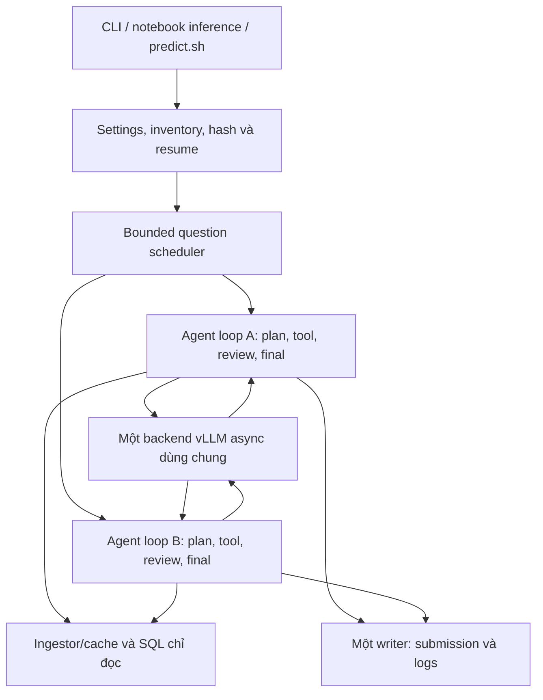

# Bổ sung runtime vLLM: thay đổi, contract và vận hành

Tài liệu bổ sung cho nhánh `codex/hai-vllm`, so với `main` tại commit `cc2ea9842d88a84fa6f9982d0dad3dbf6686ce76`. Các file Markdown có sẵn trên `main` được giữ nguyên; tài liệu này mô tả phần runtime bổ sung. Trạng thái kiểm chứng ngày 13/11/2026, sau khi đơn giản hóa lượt chạy Kaggle: **343 tests CPU qua, 7 tests tùy chọn bỏ qua; chưa kiểm GPU/Docker thật**.

Cập nhật ngày **12/11/2026**: bổ sung bàn giao RAG, cách chọn backend, base image do đội chọn, và xuất Docker archive kèm MD5 cho Test Solution. Thông tin Portal ở mục 8.7 lấy từ email BTC được cung cấp trong phiên làm việc; không suy ra loại GPU, RAM, driver hay một base image bắt buộc từ email này.

**Để chạy lần đầu:** đọc mục 4.1, chọn trường hợp ở đầu mục 6, rồi chạy các ô lệnh theo thứ tự. Mục 6–7 dành cho Colab/cloud không Docker; mục 8 dành cho Docker và Test Solution. Người tích hợp RAG đọc mục 3.1. Mục 1–3 mô tả thay đổi và giao diện bàn giao; mục 5 giúp chọn cấu hình GPU; mục 9 ghi phần đã và chưa kiểm chứng.

## 1. Phạm vi thay đổi

Giữ thuật toán nghiệp vụ, xử lý số liệu và chuỗi quyết định **plan → tool/SQL → review → final** của agent. Thay backend sinh token và cách điều phối nhiều câu đồng thời; bổ sung lifecycle, timeout/abort, log/cache identity và đóng gói offline.

Phần vận hành chịu trách nhiệm điều phối, cấu hình tài nguyên, kiểm lỗi hạ tầng và cách đóng gói. Phần nghiệp vụ/RAG do người phụ trách tương ứng đánh giá chất lượng. Không tự sửa SQL, đáp án, cắt dữ liệu đầu vào hoặc đổi số bước agent để làm một lượt chạy vượt qua kiểm bộ nhớ. Đợt cập nhật Test Solution chỉ sửa công cụ đóng gói/entrypoint/Docker/tài liệu. Đợt Kaggle bổ sung công cụ đo và cache-token metadata trong adapter vLLM; không sửa thêm agent loop hay xử lý dữ liệu.

Đối chiếu với commit gốc:

- Compiler plan, parser/protocol, SQL/tools nghiệp vụ, rule parser, projection/scoring và training không có thay đổi.
- Body `Agent.run()` giống baseline sau khi loại đúng các handler `BackendUnavailableError` và keyword chọn layout prompt tùy chọn. Loop không bị thay bằng một lần gọi model cho mỗi câu.
- Body chuẩn hóa dữ liệu giữ nguyên, được bọc thêm lock khi publish SQLite cache để tránh nhiều worker ghi cùng artifact.
- Prompt mặc định giữ baseline. Đổi thứ tự nội dung để tăng phần prefix chung là **opt-in**, `vllm.cache_prompt_prefix=false`.
- Có thay đổi hành vi lỗi hạ tầng: engine chết/OOM/abort thất bại phải dừng batch, không bị nuốt rồi biến các câu tiếp theo thành abstain. Vì vậy source runner không giữ nguyên từng byte.

Thay engine, precision hoặc batching có thể làm model thật sinh output khác; bảo toàn logic điều khiển không đồng nghĩa bảo đảm PA/đáp án giống tuyệt đối.

## 2. Các file code sửa/thêm

### File có sẵn được sửa

| File | Thay đổi |
|---|---|
| `.gitignore` | Bỏ qua environment TF/vLLM riêng |
| `pyproject.toml` | Thêm extra vLLM candidate `>=0.33,<0.34`; chưa phải GPU lock đã kiểm |
| `src/datamate/config.py` | Nested VLLMSettings, validation, env merge, số worker, offline/telemetry flags |
| `src/datamate/cli.py` | Backend vLLM, cờ Settings/VLLMSettings, alias concurrency; ask đóng backend trong finally |
| `src/datamate/application.py` | Shared backend, bounded question scheduling, một writer, runtime identity/resume, cleanup |
| `src/datamate/agent/runner.py` | `new_worker()`, `close()`, fatal propagation và hook layout opt-in; giữ nhánh quyết định nghiệp vụ |
| `src/datamate/agent/preparation.py` | Cache identity gồm engine/formatter/package; không nuốt fatal error |
| `src/datamate/agent/schema_repair.py` | Không cache lỗi engine fatal như lỗi ánh xạ |
| `src/datamate/agent/prompts.py` | Thêm nhánh layout prefix opt-in; mặc định giữ prompt gốc |
| `src/datamate/data/normalization.py` | Wrapper lock quanh publish semantic cache, không đổi body chuẩn hóa |
| `src/datamate/models/backends.py` | TF/Demo theo contract mở rộng, formatter/EOS dùng chung; lazy factory vLLM; backend lạ báo lỗi |
| `tools/create_inference_notebook.py` | Env paths/backend, extra dependency, kiểm Torch cũ sau install |
| `notebooks/DataMate_Colab_Inference.ipynb` | Sinh lại từ generator, vẫn gọi `application.run_batch()` |
| `tools/diagnose_train.py` | Snapshot bổ sung `runtime_info()` theo backend contract |
| `tools/package_colab.py` | Gói source bao gồm huongdankaggle.md nếu có; không đóng model/dataset vào source ZIP |
| `tools/package_solution.py` | Resolve bundle, verify model/wheel manifest, chọn extra, copy build helper và ghi base image đội chọn |
| `docker/Dockerfile.competition` | Base image truyền vào, kiểm Python/pip/timeout sớm, cài offline, đặt temp/cache trong vùng ghi được |
| `docker/Dockerfile.dev` | Chỉ cập nhật chú thích: image này dành cho CPU dev, không phải image GPU thi |
| `predict.sh` | Tạo temp/cache ở vùng ghi được; cho truyền Python, scratch và thời gian watchdog qua env; giữ mặc định thời gian cũ |
| `tests/test_team_layout.py` | Kiểm packaging cho cả TF/vLLM và extra tương ứng |

### File mới

| File | Trách nhiệm |
|---|---|
| `src/datamate/batching.py` | Bounded window nhiều agent loop; xử lý deadline, giữ kết quả thành công trước lỗi, cleanup |
| `src/datamate/models/contracts.py` | ChatBackend port, timeout/fatal exceptions |
| `src/datamate/models/chat_format.py` | Shared formatter, token counter/context budget, helper EOS chuyển từ backends và giữ re-export |
| `src/datamate/models/runtime.py` | Stable pre-load identity, package/source/options/template hash |
| `src/datamate/models/vllm_backend.py` | Một async engine dùng chung; request overlap, sampling, thread-local metadata, abort/shutdown |
| `configs/vllm.json` | Backend và pipeline preset, không chứa model/path/GPU riêng |
| `tools/check_context.py` | Kiểm saved messages bằng tokenizer local, không load weights |
| `tools/setup_uv.ps1` | Setup CPU nhẹ bằng uv với lock CPU có sẵn |
| `tools/run_gpu.sh` | Wrapper chạy batch và lưu metadata, không install/download |
| `tools/runtime_artifacts.py` | Model/wheel cache, manifest/hash, exact pins, online staging và offline library install |
| `tools/prepare_runtime.py` | CLI chuẩn bị bundle online hoặc verify offline |
| `tools/install_runtime.py` | Cài library/source offline, relocate model paths, check-only |
| `tools/export_solution.py` | Xuất image hoặc nhận archive có sẵn; tính MD5/SHA256 theo khối và ghi thông tin cho Portal, không upload |
| `tools/prepare_kaggle_benchmark.py` | Tạo tập con có seed, không nhãn, không sửa participant; đóng băng baseline đúng commit, cùng quy tắc lọc source ZIP hiện tại |
| `tools/profile_runtime_context.py` | Đo request đầu qua Agent.run thật rồi ngắt trước generation, chỉ dùng tokenizer |
| `tools/benchmark_runtime.py` | Timer/telemetry quanh hàm gốc, dùng được với baseline cũ; tùy chọn loader dtype được ghi rõ, không đổi agent loop |
| `tools/compare_runtime_benchmarks.py` | Kiểm các điều kiện so sánh, tính speedup và chấm local sau inference nếu có nhãn |
| `tools/kaggle_workflow.py` | Mỗi lượt GPU tự cài thư viện/tải model trước phần đo, chỉ cần Input kit; điều phối pilot/main/so sánh, timeout và lưu status/log/result theo tên cố định |
| `tools/package_kaggle_kit.py` | Gom source hiện tại/baseline/dataset thành thư mục tách biệt trong một gói upload, nhận được khi Kaggle tự giải nén |
| `tools/create_kaggle_benchmark_notebook.py`, hai notebook `DataMate_Kaggle_*.ipynb` | Sinh notebook GPU benchmark tự tải/cài và notebook CPU so sánh; đã bỏ notebook `DataMate_Kaggle_Prepare_Model.ipynb` vì không còn bước chuẩn bị riêng |
| `tests/test_kaggle_runtime_benchmark.py` | Tập con cố định/disjoint/không copy nhãn, preflight, observer, dtype override và gate so sánh |
| `tests/test_kaggle_workflow.py` | Kiểm source baseline không đổi byte, status/log/capsule khi lỗi, watchdog, kết quả đã giải nén và bootstrap từ trạng thái sạch |
| `docker/install_runtime.py` | Kiểm wheelhouse và cài dependency/source khi build image |
| `tests/test_hai_backend_foundation.py` | Contract, formatter/token/context, identity, lifecycle |
| `tests/test_vllm_backend.py` | Request overlap, sampling, timeout/abort/fatal và thread-local logs |
| `tests/test_vllm_settings.py` | Config precedence/validation, mode và layout |
| `tests/test_concurrent_batch.py` | Multi-loop cùng shop, partial output, deadline/resume và loop/prompt/SQL parity |
| `tests/test_runtime_artifacts.py` | Cache/repair/version/platform, offline/no-download, relocate, build/packaging |
| `tests/test_solution_export.py` | Checksum đúng file, đọc có giới hạn, lỗi export/đổi image tag, không ghi đè archive cũ |
| `tests/test_submission_entrypoint.py` | Thử entrypoint bằng tiến trình giả, kiểm env/temp/watchdog và chuyển tiếp cờ chạy |


## 3. Luồng hiện tại và contract bàn giao



Mỗi worker có Agent/controller state riêng: messages, plan, results/evidence, deadline, preparation/repair state. Engine và Ingestor được chia sẻ. Nhiều lượt model có thể chồng lấp trong lúc loop khác chạy SQL; vLLM tự scheduling/batching và quản lý attention/cache theo architecture. Không load một bản weights cho mỗi câu.

`question_workers` là số loop được nhận đồng thời; `max_num_seqs` là sức chứa scheduler engine. Nếu worker vượt sức chứa, request có thể chờ engine và vẫn bị tính vào timeout. Output được ghi theo thứ tự hoàn thành và ghép bằng ID, không bảo đảm thứ tự dòng giống questions.

### Backend port — `models/contracts.py`

```python
generate(messages, remaining_seconds, *, max_new_tokens=None) -> str
count_tokens(messages) -> int
runtime_info() -> dict
close() -> None
```

| Thành phần | Contract |
|---|---|
| `generate` | Trả raw assistant text cho parser hiện tại; adapter không tự diễn giải đáp án nghiệp vụ |
| `max_new_tokens` | Override phải có hiệu lực với preparation/repair; input + output reserve không vượt context |
| `remaining_seconds` | Budget của request/câu, gồm thời gian chờ engine; hết hạn phải abort |
| `count_tokens` | Cùng tokenizer/template/generation prompt/thinking setting như generate |
| `last_generation` | Metadata của chính caller thread; vLLM dùng thread-local |
| `runtime_info` | Dict JSON: source/options/packages/inventory/template/EOS và overlap statistics |
| `GenerationTimeoutError` | Lỗi câu có thể dừng, sau cancellation |
| `BackendUnavailableError` | Fatal engine/OOM/abort thất bại phải truyền ra dừng batch |
| `close` | Gọi lặp an toàn; application sở hữu lifecycle engine, không đóng shared engine sau từng câu |

Agent port của scheduler là `run(question, remaining_seconds)`, `new_worker()` và `close()`. Khi bổ sung dependency/constructor hoặc RAG, cần cập nhật `new_worker()` để giữ controller state riêng và tránh nhân bản weights/encoder trên GPU. Retriever dùng chung phải an toàn khi gọi đồng thời và được đưa đủ vào inventory/model manifest trước khi bật.

Đường concurrent chuẩn là `application.run_batch()`, CLI `datamate run`, notebook inference duy trì và Docker entrypoint. Vòng for riêng gọi `Agent.run()` vẫn tuần tự. Team200/diagnostic runner cũ có loop điều phối riêng và chưa tự chuyển sang question concurrency.

### 3.1 Bàn giao cho người làm RAG: cần sửa/thêm file nào?

**Trạng thái hiện tại:** chưa có thư mục `src/datamate/retrieval/`, chưa có `RAGSettings` và chưa có encoder/reranker được nối vào runtime. Gói offline hiện quản lý generator và assistant khai báo trong Settings; chưa tự tìm và đóng gói model RAG. Bảng dưới là việc phải làm khi tích hợp, không phải tính năng RAG đã hoàn thành.

Kế hoạch RAG gốc vẫn ở [plan RAG](plans/plan-integrate-rag-2026-11-09.md). Khi ghép vào nhánh runtime này, cần giữ các hook concurrency/lifecycle hiện có thay vì chép runner/application cũ đè lên.

| Người làm RAG sửa/thêm | Việc cụ thể khi ghép |
|---|---|
| `src/datamate/retrieval/contracts.py`, `factory.py`, `strategies.py` — tạo mới | Định nghĩa request/kết quả retrieval, chọn none/dense/rerank; có deadline, prepare, close và metadata. Không gọi trực tiếp engine vLLM từ retriever |
| `src/datamate/retrieval/adapters.py` — tạo mới | Load mỗi encoder/reranker một lần; inference theo batch có giới hạn. Có khóa/semaphore cho phần encoder nếu chưa an toàn khi nhiều loop cùng gọi; không khóa cả lượt sinh của vLLM |
| `src/datamate/retrieval/corpus.py`, `chunking.py`, `index.py`, `identity.py` — tạo mới | Đọc nguồn cho phép, chia/chỉ mục có provenance, cache đúng split/business/model/config. Không gom mọi bảng dữ liệu và mọi index vào RAM không giới hạn; đưa index ra đĩa hoặc giới hạn cache đang giữ |
| `src/datamate/retrieval/context.py` — tạo mới | Đếm toàn bộ messages bằng `backend.count_tokens()`, cộng chỗ dành cho đầu ra. Khi không vừa, giảm phần RAG theo chính sách RAG được duyệt; không tự cắt rulebook/câu hỏi/tool history gốc |
| `src/datamate/application.py` | Tạo một retriever dùng chung, chuẩn bị index trong wall budget, truyền vào Agent; thêm retriever/model/index identity vào resume/log. Đóng retriever đúng một lần ở cấp sở hữu runtime, kể cả khi khởi tạo lỗi |
| `src/datamate/agent/runner.py` — constructor, `new_worker()`, lifecycle và hook RAG | Truyền cùng retriever/ingestor/backend sang worker; messages/results của từng câu vẫn riêng. Không tạo encoder hay engine mới trong mỗi worker/câu hỏi. Chỉ ghép hook RAG đã thống nhất; giữ plan/tool/review/final và truyền lỗi engine fatal ra ngoài |
| `src/datamate/agent/prompts.py` | Nhận context RAG tùy chọn. Khi RAG tắt, messages phải giống mặc định hiện tại; giữ keyword `cache_prefix` đang có. Việc chọn nội dung/prompt RAG thuộc phần chất lượng RAG |
| `src/datamate/models/registry.py`, `artifacts.py` | Khai báo đầy đủ encoder/reranker, revision/license/số tham số; stage đủ tokenizer/module/file cần offline. Mở rộng inventory từ toàn bộ Settings, giữ tương thích API generator/assistant cũ |
| `configs/experiments/thinh/*.json` — tạo mới | Các preset RAG tắt/dense/rerank trên cùng generator và bộ câu; không sửa preset đối chứng sau khi đo |
| Tests RAG mới | RAG tắt giữ prompt/loop; multi-loop không trộn state; encoder chỉ load một lần; đúng business; budget/context; đủ model khi offline; cache/resume đổi khi nguồn hoặc RAG config đổi |

**Các file dùng chung phải phối hợp với phần runtime:**

| File | Bổ sung còn thiếu để chạy RAG cùng vLLM/offline |
|---|---|
| `src/datamate/config.py` | Thêm `RAGSettings` với batch size, thiết bị, precision, token budget, model/index paths và giới hạn cache/encode đồng thời; không hard-code vào runner |
| `src/datamate/cli.py` | Thêm parse/merge/validation cho nhóm RAG và env/CLI tương ứng. Hiện chỉ tự sinh cờ cho Settings gốc và nhóm vLLM, chưa tự hỗ trợ một nhóm nested RAG mới |
| `pyproject.toml` và GPU lock | Khai báo đủ thư viện RAG, kiểm tương thích Torch/Transformers/vLLM; chốt exact versions sau khi thử GPU |
| `src/datamate/models/runtime.py`, `application.py` | Bổ sung active models, package/config/index/source identity của RAG để cache và resume không tái dùng sai |
| `tools/runtime_artifacts.py` | Mở rộng `prepare_bundle()`/`verify_bundle()` cho full inventory và bộ dependency có RAG; hiện không thể chỉ thêm model vào registry rồi coi helper đã tự lấy model đó |
| `tools/install_runtime.py` | Đổi đường dẫn cả encoder/reranker/index config khi chuyển gói sang máy khác; hiện chỉ đổi model_dir/assistant_dir |
| `tools/package_solution.py` | Copy và rewrite path mọi active model RAG vào image, ghi full inventory; hiện quy ước path chỉ bao phủ generator/assistant |
| `docker/install_runtime.py`, `docker/Dockerfile.competition` | Cài đúng dependency RAG đã stage; các extra hiện được nhận là `llm`/`vllm`, chưa có luồng chọn RAG. Không để việc này tới lúc container đã cắt mạng |
| `tools/create_inference_notebook.py`, notebook sinh ra, công cụ benchmark đang dùng | Nhận cấu hình/dependency RAG và full inventory; tiếp tục gọi `run_batch()` để có question concurrency. Generator notebook là nơi sửa chính |

Thứ tự tích hợp: chốt schema/contract → RAG tắt vẫn chạy như cũ → ghép retriever dùng chung và context budget → mở rộng đủ model/thư viện trong gói offline → thử nhiều loop cùng business → đo GPU và Docker offline. Nếu RAG làm prompt/đáp án khác, người phụ trách RAG đánh giá; phần runtime không tự thay thuật toán để che lỗi.

Với GPU khoảng 24 GB, cần đo generator + KV cache + encoder/reranker + workspace cùng tồn tại. Có thể cấu hình encoder chạy CPU hoặc giới hạn một batch encode tại một thời điểm, nhưng phải đo độ trễ. Hạ phần VRAM dành cho vLLM không làm trọng số RAG nhỏ đi và không bảo đảm hệ thống hết OOM.

## 4. Config, env và CLI

### 4.1 Cấu hình được đọc khi nào, đổi được đến đâu?

`--config` là đường dẫn tới file JSON mà **lệnh đang chạy** sẽ đọc. File này không chỉ dùng lúc trả lời câu hỏi: công cụ chuẩn bị cũng cần biết backend và model nào để tải đúng tài nguyên. Các giá trị concurrency/context có thể được lưu trước trong file, nhưng chưa được dùng để chạy engine ở bước tải.

| Lệnh | Đọc cấu hình để làm gì? | Có chạy agent không? |
|---|---|---|
| `prepare_runtime.py --config ...` | Chọn thư viện theo backend, chọn checkpoint theo model key, lưu cấu hình dự kiến vào gói tài nguyên | Không |
| `install_runtime.py --bundle ...` | Đọc cấu hình trong gói, cài thư viện và tạo file cấu hình mới với đường dẫn model trên máy hiện tại | Không; công cụ này không nhận `--config` |
| `package_solution.py --bundle ... [--config ...]` | Chọn cấu hình đưa vào Docker; nếu bỏ `--config` thì lấy cấu hình trong gói | Không |
| `docker build ...` | Cài thư viện và chép model/cấu hình đã chuẩn bị vào image | Không; lệnh Docker này không có cờ DataMate `--config` |
| `python -m datamate run --config ...` | Khởi tạo engine và chạy agent theo cấu hình cuối cùng | Có |

Khi dùng `Settings.load()` theo cách thông thường, thứ tự ưu tiên là **mặc định → JSON → biến môi trường → tham số dòng lệnh**. Giá trị ở bên phải thắng nếu cùng thiết lập một trường. `--config` cũng được ưu tiên hơn `DATAMATE_CONFIG` khi chọn file JSON.

Ví dụ: JSON có `question_workers=2`, môi trường đặt `DATAMATE_QUESTION_WORKERS=3`, câu lệnh có `--concurrency 4` thì lần chạy dùng **4 worker**. Nếu bỏ cờ thì dùng 3; bỏ cả biến môi trường thì dùng 2. `--concurrency` và `--question-workers` là hai tên cho cùng một thiết lập.

**Không thể tùy ý thay mọi thứ trong mọi hoàn cảnh:**

| Muốn thay gì trước lần chạy mới? | Cần làm gì? |
|---|---|
| Concurrency, context, ngân sách VRAM, số GPU chia model | Truyền CLI/env mới rồi chạy lại; GPU/model phải hỗ trợ và đủ bộ nhớ. Không cần tải lại thư viện chỉ vì đổi các số này |
| Dataset, thư mục cache hoặc kết quả | Truyền đường dẫn mới; đường dẫn phải tồn tại hoặc ghi được theo vai trò tương ứng. Trong Docker phải dùng đường dẫn bên trong container |
| Model | Phải có đủ checkpoint đúng key/revision/manifest ở máy chạy. `--model-key` không tự tải model khi inference offline |
| Backend hoặc phiên bản thư viện | Phải cài sẵn bộ thư viện tương ứng; image thiếu thư viện thì cần chuẩn bị/build lại |
| Kiểu quantization | GPU, thư viện và checkpoint phải hỗ trợ. Đổi cờ không tự chuyển một checkpoint bất kỳ thành AWQ/GPTQ |
| Cấu hình khi chương trình đang chạy | Dừng rồi chạy lại; file/env không được theo dõi để tự cập nhật engine đang hoạt động |

Mỗi lần đổi cấu hình đo, dùng thư mục kết quả mới. `--resume` chỉ dành cho cùng input/code/model/cấu hình.

### 4.2 Biến viết hoa có hai loại

- `DATAMATE_QUESTION_WORKERS`, `DATAMATE_MODEL_DIR`, `DATAMATE_VLLM_MAX_NUM_SEQS`… là tên **code có đọc**. Mỗi trường Settings có tên `DATAMATE_<FIELD>`; trường vLLM có tên `DATAMATE_VLLM_<FIELD>`. Tên tự nghĩ thêm sẽ không có tác dụng nếu code không đọc nó.
- `PROJECT_ROOT`, `ARTIFACT_ROOT`, `WORKERS`… trong các ví dụ là biến để viết câu lệnh gọn. Bash thay `$WORKERS` bằng giá trị trước khi gọi Python. Đặt `WORKERS=2` một mình không đổi cấu hình DataMate; phải truyền `--concurrency "$WORKERS"`.

Trên Linux, `export` cho phép tiến trình con nhận biến. Trong Colab, đặt bằng `os.environ[...]` ở ô Python để các ô `%%bash` sau nhận được. Docker không tự nhận toàn bộ biến của máy chủ; cần cờ `-e` như mục 8.

Số dùng dạng `2`, `0.75`; boolean env dùng `true/false`. Boolean CLI dùng cặp bật/tắt, ví dụ `--vllm-enable-prefix-caching` / `--no-vllm-enable-prefix-caching`. Có thể đặt cả nhóm bằng `DATAMATE_VLLM='{"max_num_seqs":4,"dtype":"float16"}'`; biến từng trường được ưu tiên hơn nhóm.

Các công cụ xác minh gói và installer cố ý đọc cấu hình đã đóng gói với `use_env=False`, để môi trường không làm thay đổi nội dung đang kiểm. `install_runtime.py` chỉ nhận các cờ riêng của nó, không nhận toàn bộ cờ inference. Ngược lại, `package_solution.py` có đọc env Settings; nên chạy đóng gói trong shell không còn `DATAMATE_*` thử nghiệm ngoài ý muốn.

### 4.3 Các thiết lập runtime chính

**Chọn backend không cần sửa agent:** Settings mặc định là `transformers`; `configs/vllm.json` chọn `vllm`. Có thể truyền `--backend vllm` để ghi đè backend của một preset khác, sau khi đã cài extra vLLM và có checkpoint local. `build_backend()` chọn adapter; không tự quay về Transformers nếu vLLM thiếu thư viện hoặc khởi tạo lỗi. vLLM cũng dùng PyTorch bên dưới, nên thấy `torch` trong dependency/log không có nghĩa đang dùng TransformersBackend. Kiểm trường `backend`/`engine_args` trong `runtime.json` và `backend` trong `run_summary.json` sau chạy.

Ví dụ sau dùng cùng đường dẫn/profile như mục 6–7; cờ backend đổi engine, còn các trường mode/prompt/budget trong preset vẫn có hiệu lực:

```bash
set -euo pipefail
cd "$PROJECT_ROOT"
"$DATAMATE_RUNTIME_PYTHON" -m datamate run --config "$LOCAL_CONFIG" --backend vllm \
  --split-root "$SPLIT_ROOT" --cache-dir "$CACHE_DIR" --result-dir "$RESULT_DIR/backend-check" \
  --concurrency "$WORKERS" --vllm-max-num-seqs "$ENGINE_SEQS" \
  --max-context-tokens "$CONTEXT_TOKENS" --max-new-tokens "$OUTPUT_TOKENS" \
  --vllm-gpu-memory-utilization "$GPU_FRACTION" \
  --vllm-quantization "$QUANTIZATION" --vllm-load-format "$LOAD_FORMAT" --limit 2
```

| Field | Default | Tác dụng |
|---|---:|---|
| `question_workers` | auto | TF/demo: 1; vLLM: `min(4,max_num_seqs)` |
| `max_context_tokens`, `max_new_tokens`, `seed` | Settings/preset | Ngân sách dùng chung; context gồm input và output reserve |
| `tensor_parallel_size`, `pipeline_parallel_size` | 1, 1 | Chia model trên các GPU nhìn thấy |
| `gpu_memory_utilization` | 0.80 | Ngân sách VRAM của engine |
| `max_num_seqs`, `max_num_batched_tokens` | 8, null | Sức chứa engine và prefill budget; null để engine chọn token budget |
| `enable_prefix_caching`, `enable_chunked_prefill` | true, true | Năng lực cache/prefill của engine nếu architecture hỗ trợ |
| `cache_prompt_prefix`, `group_by_business` | false, true | Layout prompt opt-in; nhóm dispatch theo shop có thể tắt |
| `dtype`, `kv_cache_dtype` | auto, auto | Precision weights/activation và cache |
| `quantization`, `load_format` dưới `vllm` | none, auto | Cách load/quantize engine |
| `enforce_eager`, `cpu_offload_gb` | false, 0 | Graph/offload khi được chọn rõ |
| `init_timeout_seconds` | 600 | Hạn chờ bootstrap, bị giới hạn tiếp bởi budget còn lại |
| `abort_timeout_seconds`, `shutdown_timeout_seconds` | 10, 20 | Hạn chờ cancellation và shutdown |
| `extra_engine_args`, `extra_sampling_params` | {}, {} | JSON kwargs bổ sung; sampling mặc định greedy temperature=0 |

Không dùng `--quantization 4bit` cho vLLM: đó là tùy chọn Transformers. vLLM dùng `--vllm-quantization` và `--vllm-load-format`. `single/self_review` được hỗ trợ; speculative assistant bị từ chối sớm. Extra kwargs không được ghi đè model/tokenizer/context/seed/EOS/output contract hoặc bật thêm draft/LoRA model ngoài inventory.

Các ô lệnh đầy đủ ở mục 6–8. `configs/vllm.json` dùng self_review, tối đa 6 bước và output 768. Không chọn config thì Settings mặc định mode single; hai mode không tương đương số model call. Model key phải có metadata hợp lệ trong registry; model mới cần revision/license/parameter count, không bỏ verifier để load path bất kỳ.

`CUDA_VISIBLE_DEVICES` chọn GPU trước import engine. Native cache paths có thể đặt bằng `VLLM_CACHE_ROOT`/`VLLM_CONFIG_ROOT`, ngoài dataset. Đổi code/config/model/runtime/IDs cần result_dir mới; resume kiểm identity.

## 5. Chọn GPU, model và ngân sách context

Các profile sau là **điểm thử, chưa đo fit/PA/tốc độ trên GPU thật**. Dung lượng VRAM chưa đủ xác định kiến trúc hoặc khả năng BF16/FP8/quantization. Cần lưu tên GPU, driver, Torch/CUDA/vLLM và kiến trúc checkpoint.

**Làm rõ hai giới hạn:** `max_context_tokens` mặc định 16.384 là input + lịch sử + chỗ dành cho output; `max_new_tokens=768` trong preset là phần đầu ra mỗi lượt, không phải context. Đã đếm bằng tokenizer pin của Qwen9B: phần prompt tĩnh + rulebook/README/câu hỏi, chưa catalog/preflight/history, dài 7.365–10.800 token trên participant 200. Độ dài đầy đủ phải đo bằng `tools/profile_runtime_context.py`; không suy context từ số dòng bảng hoặc tự tăng lên 100K chỉ vì checkpoint hỗ trợ.

Với **Kaggle T4×2**, hướng dẫn có cell nhập sẵn, dataset 24 câu và cách đọc số đo ở [huongdankaggle.md](../huongdankaggle.md). Bản đầu chọn Qwen9B FP16 không quantize, TP2, workers/seqs 2/2, prefill 2048, eager, context theo preflight tối đa 32K, VRAM fraction thử 0.88, prefix caching bật và layout prompt gốc giữ nguyên. Weights FP16 lý tưởng 17,98 GiB toàn model, khoảng 8,99 GiB/card nếu chia đều; còn phải chừa KV/linear state/workspace/activation. Không cam kết fit trước pilot GPU.

Quy trình Kaggle chạy hoàn toàn trên Kaggle theo thời gian: upload `kaggle-runtime-kit.zip` → gắn duy nhất kit vào hai notebook GPU, bật Internet → theo dõi pilot 4 câu → Save Version/Save & Run All cho main 24 câu → CPU so sánh Output hai version. Mỗi lượt GPU tự cài cùng nhóm thư viện, kiểm T4 rồi tải checkpoint đúng revision vào thư mục tạm; không cần notebook chuẩn bị hay Dataset model/thư viện. Gói upload có `current/`, `baseline/`, `benchmark/`, không có ZIP lồng; bootstrap nhận manifest khi Kaggle đã giải nén. Code tự ghi `torch_main_result.zip`, `vllm_main_result.zip`, status/log tương ứng và `comparison.txt/csv/json`; không giả định tên archive do giao diện Kaggle tạo.

Thời gian tải/cài và context preflight nằm ngoài phép đo. `cold_total_seconds` tính từ lúc gọi `run_batch()`, gồm kiểm hash/load model và xử lý câu hỏi; `inference_seconds` tính sau khi tạo agent xong. `elapsed_seconds` trong status là thời gian toàn quy trình, không dùng làm tốc độ inference. Model/venv nằm dưới thư mục tạm `/tmp/datamate-kaggle` mặc định, có thể đổi `work_root` trong SETTINGS; Output chỉ giữ kết quả/log. Bản thay đổi này bỏ task `prepare_model` trong công cụ Kaggle và hoàn tác phần chuẩn bị bộ thư viện vừa thử bổ sung. Công cụ bundle/Docker offline ở mục 6–8 giữ nguyên: nộp bài vẫn phải đóng sẵn model và thư viện trước khi BTC cắt mạng.

Sửa lỗi tạo môi trường được báo từ Kaggle: dùng `venv --without-pip`, kiểm Python thật sự thuộc venv, kiểm pip và bootstrap bằng `get-pip.py` chính thức khi thiếu/hỏng. Không coi executable còn sót sau lỗi ensurepip là môi trường hoàn chỉnh. Không cài vào Python hệ thống. Đã thử tạo venv không pip và cài pip lại thật trong thư mục CPU tạm; không tải Torch/vLLM/weights cho kiểm tra này. `DATAMATE_GET_PIP_URL` cho đổi nguồn HTTPS khi cần; URL và SHA256 script bootstrap được lưu trong status. Đây là bước chuẩn bị online, không được đưa vào inference Docker offline.

T4 cần `dtype=float16`; không dùng `auto` để tình cờ chọn BF16 từ config checkpoint. Hai card có tổng dung lượng lớn hơn không đồng nghĩa BF16/FP8 được hỗ trợ. [Platform CUDA của vLLM v0.33.0](https://github.com/vllm-project/vllm/blob/v0.33.0/vllm/platforms/cuda.py). Nếu chỉ có một T4, FP16 Qwen9B không vừa weights; có thể thử BNB TP1 như một phép so deployment riêng, hoặc chọn model/GPU đã kiểm, không đổi quantization một phía rồi gọi đó là speedup thuần engine.

Baseline cũ cũng có nhánh tự chọn BF16 bằng API Torch có thể tính emulation. Harness Kaggle nhận `--transformers-dtype float16` để ép precision tại loader, lưu override trong identity và kiểm dtype thực trong so sánh; không sửa source frozen hay thuật toán generate. Adapter vLLM bổ sung `last_generation.cached_tokens` từ RequestOutput, `null` nếu chưa được cung cấp; không suy cache hit từ mức overlap. Đây là metadata mới, không thay prompt/sampling/loop.

```bash
nvidia-smi --query-gpu=name,memory.total,driver_version --format=csv
python -c 'import torch; print(torch.__version__, torch.version.cuda); print(torch.cuda.is_available(), torch.cuda.is_bf16_supported())'
```

| GPU gần đúng | Model/precision để thử | Context tổng | Workers / seqs / TP | VRAM fraction thử |
|---|---|---:|---|---:|
| 16 GB | Qwen9B 4 bit nếu architecture/kernel hỗ trợ | 16K nếu fit | 1 / 1 / 1 | 0.80 |
| 24 GB | Qwen9B 4 bit; thử BNB từ base artifact hợp lệ | 16K nếu fit | 2 / 4 / 1 | 0.75–0.80; bắt đầu 0.70 nếu chia với RAG |
| 24 GB | Qwen9B BF16/FP16, generator-only | 16K nếu còn đủ cache | 1 / 1 / 1 | 0.85; có thể không đủ |
| 32 GB | Qwen9B BF16 hoặc Gemma12B 4/8 bit có hỗ trợ | 16K trước | 2 / 4 / 1 | 0.80–0.85, thấp hơn nếu chia model |
| 48 GB | Qwen9B/Gemma12B BF16 | 16K trước; 32K khi cần/fit | 2–4 / 4–8 / 1 | 0.80–0.85 |
| 2×32 GB | Một engine TP2 hoặc TP1 sau đo đối chứng | 16K trước | 2–4 / 4–8 / 1 hoặc 2 | Theo cách chia tài nguyên |
| 2×T4 ~16 GB/card | Qwen9B FP16 không quantize; Turing, chưa kiểm kernel/model thực tế | Preflight 16–32K | 2 / 2 / 2; prefill 2048, eager | 0.88 điểm thử |

Hai card 32 GB không tự thành một vùng VRAM 64 GB cho TP1. Hai replica cũng cần controller phân phối câu; runtime hiện có một shared engine, không tự tạo data-parallel replicas. TP2 có chi phí liên GPU, không mặc định nhanh hơn.

Số tham số lấy từ registry/evidence hiện có: Qwen9B 9.653.104.368; Gemma12B 11.959.730.224; upscaled14B 14.599.485.040. Payload BF16 lý tưởng lần lượt khoảng 17,98 / 22,28 / 27,19 GiB, **chưa** activation, cache, graph/workspace và quantization metadata. 4 bit không đồng nghĩa dùng đúng một phần tư tổng VRAM runtime.

Tổng inference models vẫn phải ≤15B, tính cả encoder/reranker/assistant. Hai encoder trong tài liệu hiện có cộng 1.135.510.529 tham số; ghép với upscaled14B vượt trần. Quantization không giảm parameter count theo luật. Checkpoint phải pin revision/cutoff/license; số ghi trong tên model không đủ thay inventory.

Thử BNB trên vLLM bằng các cờ bổ sung:

```bash
--vllm-quantization bitsandbytes --vllm-load-format bitsandbytes
```

BNB NF4 của TF, AWQ, GPTQ và FP4 không tương đương. Checkpoint packed AWQ/GPTQ cần manifest/lineage/parameter accounting phù hợp; verifier hiện tại không tự coi số phần tử packed tensors là số tham số gốc.

Khi OOM: kiểm phiên khác giữ VRAM → hạ workers/seqs → kiểm memory fraction và tài nguyên RAG → chọn quantization hợp lệ hoặc GPU phù hợp. Giảm fraction không làm weights nhỏ hơn. Hạ context chỉ sau token preflight; lịch sử repo từng ghi prompt ban đầu khoảng 8–12K, nên 4K/8K có thể không đủ. Không cắt rulebook/câu hỏi tự động.

```bash
python tools/check_context.py --model-dir "$MODEL_DIR" --messages "$SAVED_LOG_JSON" \
  --context-tokens 16384 --output-tokens 768
```

Tool nhận saved messages/initial_messages/input_messages, chỉ load tokenizer local. Repair/preparation dùng reserve của chính phase, không áp 768 cho mọi call. Initial prompt fit không bảo đảm history sau các lượt tool cũng fit.

### 5.1 Đã giới hạn gì, và phần nào vẫn phải đo bộ nhớ?

| Vấn đề | Cơ chế hiện có / cách cấu hình |
|---|---|
| Nhiều câu cùng làm GPU quá tải | Một engine dùng chung, không nhân weights theo câu. `question_workers` giới hạn loop được nhận; `max_num_seqs` giới hạn request engine; hàng đợi gửi việc có giới hạn |
| Prompt quá dài | Đếm input + output reserve trước khi gửi engine; vượt thì báo lỗi. Không tự cắt rulebook/câu hỏi hoặc đổi logic agent |
| Request hết hạn còn giữ tài nguyên | Timeout gửi abort và chờ xác nhận; engine lỗi fatal thì dừng batch. Các câu đã ghi/flush được giữ |
| Model/RAG chia VRAM | Điều chỉnh `gpu_memory_utilization`, context, workers/seqs và batch RAG. Đây là ngân sách, không phải cam kết chống mọi OOM |
| RAM máy chủ | Chưa có trần RAM chung cho mọi cache/dữ liệu trong process. Người làm RAG phải giới hạn batch/index/cache; `cpu_offload_gb` có thể chuyển áp lực từ VRAM sang RAM |
| Bộ nhớ dùng chung trong Docker | Cấu hình `--shm-size` khi tự thử; cần đối chiếu giới hạn thật của môi trường chấm. Shared memory cũng dùng RAM máy chủ |
| File image lớn khi xuất/nộp | `export_solution.py` dùng Docker save ra đĩa, hash theo khối mặc định 8 MiB; không đọc toàn bộ image vào RAM |

Khi lỗi bộ nhớ, phân biệt **CUDA OOM** (VRAM), **Killed/exit 137** (có thể do giới hạn RAM hoặc bị SIGKILL; cần xem thêm log/trạng thái), và lỗi `/dev/shm`/bus error. Không coi ba loại này là một lỗi context. Dùng `nvidia-smi`, `free -h`, `docker stats` và log để xác định; trường hợp bị hệ điều hành giết process có thể không kịp ghi summary/cleanup.

Thứ tự khắc phục: kiểm tiến trình khác chiếm tài nguyên → hạ số câu/seqs hoặc batch RAG → kiểm context/token thực tế → chọn precision/model/GPU phù hợp và thử lại trong thư mục kết quả mới. Nếu prompt không vừa thì chuyển cho người phụ trách prompt/RAG xử lý theo logic đã duyệt; phần runtime không tự bỏ nội dung hay giảm số bước agent. Không có cơ chế âm thầm đổi model/backend hoặc chạy lại câu bằng thuật toán khác để che OOM.

## 6. Bắt đầu: chọn trường hợp và chuẩn bị khi có mạng

### 6.1 Toàn cảnh: chạy gì, lúc nào?

Luồng thông thường là **chuẩn bị source/data → tải model và bộ cài thư viện → cài lên máy chạy → thử ít câu → chạy bộ câu cần đo → đóng Docker sau khi đã kiểm GPU**.

| Tình trạng hiện tại | Các bước cần chạy |
|---|---|
| Laptop Windows không GPU | Chỉ viết code/test CPU ở mục 9. Không tải/cài vLLM theo mục này |
| Colab/cloud Linux có GPU và mạng, chưa có tài nguyên | Mục 6.2 → 6.3 → 6.4 → 6.5 → 7.1 → 7.2 |
| Cùng máy, đã cài và đã có model | Đặt lại biến nếu mở phiên mới, rồi mục 7. Không cần tải/cài lại mỗi lượt |
| Máy Linux mới không có mạng, đã nhận source và gói tài nguyên | Mục 6.2 → 6.3 → 7.4; không chạy bước tải 6.4 |
| Cần Docker để nộp/Test Solution | Kiểm trên GPU trước, rồi mục 8. Đội chọn base image, chuẩn bị đúng môi trường đó, xuất archive và MD5 |

Ba lệnh có vai trò riêng:

- `prepare_runtime.py`: gom model, bộ cài thư viện và cấu hình thành một thư mục để dùng lại/chuyển máy. Thêm `--install` thì cài thư viện vào Python được chỉ định. **Chưa trả lời câu hỏi.**
- `install_runtime.py`: dùng thư mục đã chuẩn bị để cài thư viện và source, tạo cấu hình đúng đường dẫn máy hiện tại. **Không cần mạng, chưa trả lời câu hỏi.**
- `python -m datamate run`: nạp model lên GPU và chạy các agent loop. **Đây mới là bước xử lý câu hỏi.**

### 6.2 Điền đường dẫn và cấu hình một lần

Source đã được clone/giải nén, dataset đã được chuyển riêng. Các ví dụ dưới dùng **Linux Bash**, không dán nguyên vào PowerShell. Python chạy công cụ cần phiên bản 3.11 trở lên.

Chọn **một** trong hai ô thiết lập sau. Những giá trị `/work/...`, `qwen35-9b`, `run-01` chỉ là ví dụ, thay theo máy và model được chọn.

**Terminal Linux/cloud:** sửa các dòng có chú thích rồi chạy trong cùng shell.

```bash
export PROJECT_ROOT="/work/AI_ZALO2026-LoveYou3500"  # thư mục chứa pyproject.toml
export ARTIFACT_ROOT="/work/datamate-artifacts"       # ổ lưu model và bộ cài; nên là ổ giữ được qua phiên
export SPLIT_ROOT="/work/datasets/train/train"        # chứa questions.jsonl, rulebook.md, calendar.csv, data/
export MODEL_KEY="qwen35-9b"                          # key đã có trong registry
export MODEL_SOURCE="$PROJECT_ROOT/models/$MODEL_KEY" # model đã có; nếu chưa có sẽ tải bản base đã pin
export VENV_DIR="$PROJECT_ROOT/.venv-vllm"
export DATAMATE_RUNTIME_PYTHON="$VENV_DIR/bin/python"
export LOCAL_CONFIG="$ARTIFACT_ROOT/runtime-local.json"
export CACHE_DIR="/work/datamate-cache"               # nơi ghi cache, nằm ngoài dataset
export RESULT_DIR="$PROJECT_ROOT/outputs/runs/hai/run-01"

# Profile khởi đầu để thử GPU khoảng 24 GB; chưa được kiểm trên GPU thật.
export WORKERS="2"
export ENGINE_SEQS="4"
export CONTEXT_TOKENS="16384"
export OUTPUT_TOKENS="768"
export GPU_FRACTION="0.75"
export QUANTIZATION="bitsandbytes"
export LOAD_FORMAT="bitsandbytes"
```

**Colab:** chọn GPU trong cài đặt runtime, đưa source/data lên máy hoặc mount Drive trước. Chạy ô Python này thay ô Bash thiết lập bên trên. Sửa ba đường dẫn đầu cho đúng vị trí đã giải nén/mount. Nếu muốn giữ tài nguyên qua phiên, đặt `ARTIFACT_ROOT` trên ổ lưu lâu dài; `/content` sẽ mất khi phiên bị xóa.

```python
import os
from pathlib import Path

project = Path('/content/AI_ZALO2026-LoveYou3500')  # sửa theo source thực tế
artifacts = Path('/content/datamate-artifacts')   # có thể đổi sang thư mục trên Drive đã mount
split = Path('/content/datasets/train/train')    # sửa theo dataset thực tế
model_key = 'qwen35-9b'
os.environ.update({
    'PROJECT_ROOT': str(project), 'ARTIFACT_ROOT': str(artifacts),
    'SPLIT_ROOT': str(split), 'MODEL_KEY': model_key,
    'MODEL_SOURCE': str(project / 'models' / model_key),
    'VENV_DIR': str(project / '.venv-vllm'),
    'DATAMATE_RUNTIME_PYTHON': str(project / '.venv-vllm/bin/python'),
    'LOCAL_CONFIG': str(artifacts / 'runtime-local.json'),
    'CACHE_DIR': '/content/datamate-cache',
    'RESULT_DIR': str(project / 'outputs/runs/hai/run-01'),
    'WORKERS': '2', 'ENGINE_SEQS': '4', 'CONTEXT_TOKENS': '16384',
    'OUTPUT_TOKENS': '768', 'GPU_FRACTION': '0.75',
    'QUANTIZATION': 'bitsandbytes', 'LOAD_FORMAT': 'bitsandbytes',
})
```

**Cách chạy các ô Bash còn lại trên Colab:** thêm `%%bash` vào dòng đầu của mỗi ô. Mỗi ô là một shell mới, nên các ô đã ghi lại `cd "$PROJECT_ROOT"`; các biến được nhận từ `os.environ` phía trên. Nếu thay một biến để dùng cho nhiều ô sau, sửa lại trong ô Python; `export` trong một ô `%%bash` không lưu sang ô kế tiếp.

Ý nghĩa các đường dẫn:

| Biến | Trỏ tới gì? | Có phải mang sang máy khác không? |
|---|---|---|
| `PROJECT_ROOT` | Source có `src/`, `tools/`, `pyproject.toml` | Có, bằng Git/ZIP source |
| `ARTIFACT_ROOT` | Model, bộ cài thư viện, cấu hình và danh sách kiểm tra | Có nếu máy nhận không có mạng; chuyển cả thư mục |
| `SPLIT_ROOT` | Dataset đầu vào; không ghi model/cache vào đây | Cấp riêng cho từng môi trường |
| `MODEL_SOURCE` | Checkpoint local có `artifact_manifest.json`, hoặc vị trí chưa tồn tại nếu cần tải base | Không cần chuyển riêng nếu đã có trong `ARTIFACT_ROOT` |
| `VENV_DIR`, `DATAMATE_RUNTIME_PYTHON` | Thư viện đã cài cho Python của máy chạy | Tạo/cài trên máy nhận, không copy venv Windows sang Linux |
| `LOCAL_CONFIG` | JSON được installer tạo, trỏ model tới vị trí hiện tại | Tạo lại khi chuyển thư mục/máy |
| `CACHE_DIR`, `RESULT_DIR` | Cache và kết quả; phải ghi được, nằm ngoài dataset | Kết quả cần được lưu lại; mỗi cấu hình đo dùng result mới |

`WORKERS` là số câu có agent loop hoạt động đồng thời; `ENGINE_SEQS` là số request engine cho xử lý đồng thời. `CONTEXT_TOKENS` gồm cả phần đầu vào và chỗ dành cho đầu ra; tăng giá trị này thường cần thêm VRAM. `GPU_FRACTION=0.75` cho engine ngân sách khoảng 75% VRAM, không làm trọng số nhỏ đi. Profile trên chọn BNB để thử giảm bộ nhớ trọng số; chưa bảo đảm kernel/model/GPU cụ thể hỗ trợ. Nếu đã xác nhận model không quantize đủ bộ nhớ, đổi cả `QUANTIZATION=none` và `LOAD_FORMAT=auto`. Các profile khác xem mục 5.

### 6.3 Tạo Python environment — một lần cho mỗi máy/phiên mới

```bash
set -euo pipefail
cd "$PROJECT_ROOT"
python3 --version
test -f pyproject.toml
test -f "$SPLIT_ROOT/questions.jsonl"
if [ ! -x "$DATAMATE_RUNTIME_PYTHON" ]; then
  python3 -m venv "$VENV_DIR"
fi
"$DATAMATE_RUNTIME_PYTHON" --version
```

Ô này kiểm đường dẫn cơ bản rồi tạo Python riêng, chưa tải model hay thư viện GPU. Nếu đã cài `uv`, có thể thay dòng `python3 -m venv "$VENV_DIR"` bằng `uv venv --seed --python python3 "$VENV_DIR"`. Không cần activate vì mọi lệnh đều chỉ rõ Python đích. Venv riêng tránh thay Torch của kernel Colab; các lệnh inference sau chạy trong tiến trình riêng.

### 6.4 Có mạng: tải tài nguyên và cài thư viện

Chạy lần đầu hoặc khi thay backend/bộ phiên bản/model cần chuẩn bị. Không cần chạy lại chỉ vì đổi số worker hoặc dataset. Nếu model cần quyền truy cập, cấp quyền và đặt `HF_TOKEN` trong môi trường trước bước này; không ghi token vào source/config được chia sẻ.

```bash
set -euo pipefail
cd "$PROJECT_ROOT"
python3 tools/prepare_runtime.py --config "$PROJECT_ROOT/configs/vllm.json" \
  --artifact-root "$ARTIFACT_ROOT" --python "$DATAMATE_RUNTIME_PYTHON" \
  --model-key "$MODEL_KEY" --model-dir "$MODEL_SOURCE" \
  --split-root "$SPLIT_ROOT" --cache-dir "$CACHE_DIR" --result-dir "$RESULT_DIR" \
  --install
```

Trong lệnh này:

- `--config` chọn preset vLLM/self_review; `--model-key` chỉ model cần chuẩn bị. Không cần truyền concurrency ở bước tải.
- `--model-dir` là nơi tìm checkpoint có sẵn. Nếu không có artifact hợp lệ, công cụ tải bản base đúng revision trong registry; tên key phải có trong registry, không phải tên Hugging Face tùy ý.
- `--artifact-root` là nơi gom tài nguyên. `--python` chỉ Python sẽ dùng thư viện. `--install` cài thư viện vào Python đó để bước tải model sử dụng được dependency cần thiết.
- Các đường dẫn dataset/cache/result được ghi vào cấu hình dự kiến và kiểm vị trí ghi; bước này không chạy các câu hỏi. Khi inference vẫn có thể truyền đường dẫn khác.

**Kết quả mong đợi:** cuối lệnh in đường dẫn `bundle.json`, config và wheelhouse. Thư mục sẽ có dạng:

```text
ARTIFACT_ROOT/
  bundle.json                         # danh sách tài nguyên và checksum
  runtime-<hash>.json                  # cấu hình gốc đi kèm gói; không sửa trực tiếp
  models/<model-key>/<revision-or-hash>/
  wheelhouses/<identity-hash>/         # bộ cài .whl, exact versions và checksum
```

Code đã xử lý những việc sau khi chuẩn bị/cài:

| Tình huống | Cách xử lý hiện tại |
|---|---|
| Model đúng key/revision/hash đã có | Dùng lại; model ngoài thư mục tài nguyên được copy vào một lần |
| Thiếu/hỏng/sai base model | Khi online, tải đúng bản đã pin vào thư mục mới; giữ bản cũ để tránh ghi đè |
| Model fine-tune có thông tin nguồn nhưng bị hỏng | Báo lỗi, không âm thầm đổi sang base model |
| Bộ cài đã tải đúng backend/Python/platform và checksum | Dùng cache, không tải lại |
| Library đã cài đúng phiên bản của bộ cài | Không cài lại package đó |
| Library thiếu hoặc khác phiên bản | Cài từ bộ cài local, kiểm checksum và chạy `pip check` để phát hiện dependency không khớp |
| Không có bản `.whl` phù hợp | Dừng ở bước tải; không tự biên dịch package nguồn bằng một bộ compiler chưa chuẩn bị |
| Chuyển bộ cài sang Python/platform khác | Báo không khớp; cần chuẩn bị lại trên môi trường đích |

Khi chưa truyền `--requirements`, công cụ chọn phiên bản thỏa `pyproject.toml`, rồi lưu exact versions/checksum đã chọn. Đây **chưa phải bộ phiên bản được kiểm GPU**. Nếu đã có file khóa GPU kiểm thành công, thêm `--requirements "/duong-dan/gpu-lock.txt"` vào lệnh trên; file cần đủ runtime và `setuptools`/`wheel`. Chỉ dùng file này trên môi trường tương thích đã kiểm, không dùng lock CPU Windows cho vLLM Linux.

Việc tải dùng `pip download --only-binary=:all:`. Cài lại dùng local wheels với `--no-index --find-links --require-hashes`. Có thể truyền `--index-url`/`--extra-index-url` nếu cần kho thư viện riêng. Checksum phát hiện nội dung thay đổi, không chứng minh bộ thư viện tương thích GPU/CUDA. Cần thử GPU thật ở mục 7.

### 6.5 Cài source và tạo cấu hình cho máy hiện tại

Chạy sau 6.4, hoặc khi nhận gói có sẵn ở máy mới. Lệnh này dùng tài nguyên local, không tải qua mạng.

```bash
set -euo pipefail
cd "$PROJECT_ROOT"
python3 tools/install_runtime.py --bundle "$ARTIFACT_ROOT/bundle.json" \
  --python "$DATAMATE_RUNTIME_PYTHON" --project-root "$PROJECT_ROOT" \
  --output-config "$LOCAL_CONFIG"
```

`--bundle` chỉ danh sách tài nguyên, `--project-root` chỉ source cần cài, `--output-config` là JSON mới sẽ được tạo. Installer kiểm/cài thư viện, cài source theo kiểu dùng trực tiếp thư mục source, rồi sửa đường dẫn model trong **file mới** theo vị trí hiện tại. Nó giữ nguyên `runtime-<hash>.json` đã kiểm checksum. Cuối bước này có `runtime-local.json`; chuyển sang mục 7 để chạy câu hỏi.

## 7. Chạy trên Colab/cloud GPU, không Docker

### 7.1 Thử ít câu trước

Điều kiện: đã xong 6.5, có GPU hỗ trợ profile được chọn. Lệnh kiểm GPU không tải model:

```bash
set -euo pipefail
cd "$PROJECT_ROOT"
nvidia-smi --query-gpu=name,memory.total,driver_version --format=csv
"$DATAMATE_RUNTIME_PYTHON" -c 'import torch; print(torch.__version__, torch.version.cuda); print("CUDA available:", torch.cuda.is_available())'
```

Sau đó thử tối đa hai câu. `--limit 2` dùng để kiểm luồng load model → agent → output, chưa đủ đánh giá chất lượng hay tốc độ toàn bộ tập.

```bash
set -euo pipefail
cd "$PROJECT_ROOT"
"$DATAMATE_RUNTIME_PYTHON" -m datamate run --config "$LOCAL_CONFIG" \
  --split-root "$SPLIT_ROOT" --cache-dir "$CACHE_DIR" --result-dir "$RESULT_DIR/smoke" \
  --concurrency "$WORKERS" --vllm-max-num-seqs "$ENGINE_SEQS" \
  --max-context-tokens "$CONTEXT_TOKENS" --max-new-tokens "$OUTPUT_TOKENS" \
  --vllm-gpu-memory-utilization "$GPU_FRACTION" \
  --vllm-quantization "$QUANTIZATION" --vllm-load-format "$LOAD_FORMAT" \
  --limit 2
```

Đây mới là lúc model được nạp lên GPU. `--config` cung cấp nền cấu hình; các cờ phía sau ghi đè từng giá trị cho **lần chạy này**, không ghi ngược vào file JSON. Vì vậy có thể đổi concurrency/context ở đây dù bước tải dùng giá trị khác. Model và thư viện vẫn phải tồn tại, đúng định dạng và phù hợp GPU.

Kiểm `submission.jsonl`, `logs/` và `run_summary.json` dưới `$RESULT_DIR/smoke` nếu lượt chạy kết thúc và ghi được các file tương ứng. Kiểm cả timeout/abstain/lỗi model trong log; chỉ thấy file submission chưa đủ kết luận model chạy đúng. Nếu engine lỗi/OOM, xử lý và thử lại với thư mục kết quả mới trước khi chạy tập lớn.

### 7.2 Chạy bộ câu cần đánh giá

Sau khi thử nhỏ thành công, chạy ô sau. Bỏ `--limit` để chạy hết câu trong split; nếu đo trên một tập chọn trước, thêm `--ids "/duong-dan/ids.json"` (file JSON array ID). Không dùng kết quả hai tập khác nhau để so tốc độ/chất lượng backend.

```bash
set -euo pipefail
cd "$PROJECT_ROOT"
"$DATAMATE_RUNTIME_PYTHON" -m datamate run --config "$LOCAL_CONFIG" \
  --split-root "$SPLIT_ROOT" --cache-dir "$CACHE_DIR" --result-dir "$RESULT_DIR/full" \
  --concurrency "$WORKERS" --vllm-max-num-seqs "$ENGINE_SEQS" \
  --max-context-tokens "$CONTEXT_TOKENS" --max-new-tokens "$OUTPUT_TOKENS" \
  --vllm-gpu-memory-utilization "$GPU_FRACTION" \
  --vllm-quantization "$QUANTIZATION" --vllm-load-format "$LOAD_FORMAT"
```

Kết quả ở `$RESULT_DIR/full/submission.jsonl`, log ở `$RESULT_DIR/full/logs/`. Trên Colab, tải/lưu kết quả trước khi phiên bị xóa. Thư mục `/content` không phải nơi lưu lâu dài.

### 7.3 Đổi GPU, số worker hoặc context cho lượt tiếp theo

Ví dụ muốn thử bốn loop đồng thời: sửa `WORKERS=4`, `ENGINE_SEQS=4`, đổi `RESULT_DIR` sang `run-02`, rồi chạy lại 7.1 và 7.2. Trên terminal dùng `export`; trên Colab sửa `os.environ` trong ô 6.2. **Không chạy lại bước tải chỉ vì đổi các số này.**

Khi cần thay model, hãy chuẩn bị đúng model ở 6.4 rồi tạo lại local config ở 6.5. Khi thay backend hoặc phiên bản thư viện, chuẩn bị/cài lại bộ tương ứng. Chuyển GPU khác loại nhưng cùng Python/platform vẫn cần kiểm khả năng CUDA/kernel; kiểm platform trong gói không chứng minh mọi GPU đều chạy được.

Các cờ ở 7.1/7.2 chưa được lưu vào `LOCAL_CONFIG`. Để người khác chạy bằng một file config hoặc để đóng Docker, cần ghi lại profile đã chọn như ô 8.2. Không mặc định rằng CLI đã tự sửa JSON.

### 7.4 Máy không có mạng, đã nhận tài nguyên

Mang sang **source + toàn bộ `ARTIFACT_ROOT` + dataset phù hợp**. Source ZIP riêng không có model hay bộ cài. Trên máy nhận, thực hiện 6.2 với đường dẫn mới và 6.3 để tạo Python environment. Python/platform phải khớp bộ cài đã chuẩn bị; GPU/driver vẫn phải tương thích.

Đầu tiên chỉ kiểm gói có đầy đủ và đúng checksum:

```bash
set -euo pipefail
cd "$PROJECT_ROOT"
python3 tools/prepare_runtime.py --artifact-root "$ARTIFACT_ROOT" --offline
```

`--offline` ở đây chỉ xác minh gói đã có, không dùng config mới để chọn tải thêm và không chạy agent. Sau đó chạy **6.5 → 7.1 → 7.2**; cả installer và inference dùng tài nguyên local. Nếu thiếu/hỏng tài nguyên, cần bổ sung trên máy có mạng rồi chuyển lại.

Nếu chỉ muốn kiểm gói và các phiên bản thư viện đang cài, không cài/ghi config:

```bash
set -euo pipefail
cd "$PROJECT_ROOT"
python3 tools/install_runtime.py --bundle "$ARTIFACT_ROOT/bundle.json" \
  --python "$DATAMATE_RUNTIME_PYTHON" --project-root "$PROJECT_ROOT" --check-only
```

`--check-only` không thay cho bước cài: máy chưa đủ thư viện sẽ báo lỗi. Nếu chỉ muốn đóng ZIP source từ laptop, chạy trong PowerShell ở gốc repo:

```powershell
.\.venv\Scripts\python.exe tools/package_colab.py --output outputs/packages/datamate-source.zip
```

## 8. Đóng Docker và thử offline trước khi nộp

### 8.1 Khi nào làm bước này?

Đội tự chọn base image phù hợp; không phải chờ một base do BTC phát hành để bắt đầu đóng gói. Email Test Solution được cung cấp chưa quy định base image bắt buộc. Các giới hạn GPU/driver/RAM/mount thực tế vẫn cần đối chiếu tài liệu môi trường chấm; hiện chưa có image/GPU rehearsal đã được xác nhận trong nhánh này.

Trước build cần có: source, model, bộ cài thư viện được chuẩn bị trên môi trường tương thích Python/platform/CUDA của base đã chọn, và base image đã tải về máy. Gói tải trên Colab không mặc nhiên phù hợp base. Có thể lấy image NVIDIA CUDA/PyTorch hoặc image vLLM làm nền, nhưng base phải có Python 3.11+, pip, shell và `timeout`, đồng thời tương thích vLLM/Torch/CUDA/GPU sẽ chạy. Không dùng image CPU dev làm image vLLM GPU.

Một lựa chọn để đánh giá là repo image `vllm/vllm-openai` của dự án vLLM; chọn tag khớp bộ phiên bản đã thử, rồi pin digest. Không dùng `latest` làm bản nộp tái lập. Dockerfile của bài làm thay entrypoint bằng `predict.sh`, không mở API server. Đây là lựa chọn của đội, chưa phải kết quả đã kiểm trên GPU. Xem [hướng dẫn Docker chính thức của vLLM](https://docs.vllm.ai/en/latest/deployment/docker/).

Trên terminal Linux có Docker, đặt đường dẫn mục 6.2 theo máy này. Thêm các biến sau; thay giá trị mẫu trước khi chạy:

```bash
export BASE_IMAGE="THAY_BANG_IMAGE_TAG_HOAC_DIGEST_DO_DOI_CHON"
export BUILD_CONTEXT="$PROJECT_ROOT/outputs/packages/docker-context-01" # thư mục mới/rỗng
export RELEASE_CONFIG="$ARTIFACT_ROOT/release-config.json"
export IMAGE_TAG="datamate:vllm-01"
export RESULT_DIR="$PROJECT_ROOT/outputs/runs/hai/docker-01"
export SCRATCH_DIR="/work/datamate-docker-scratch"
export IMAGE_TAR="$PROJECT_ROOT/outputs/packages/datamate-vllm-01.tar"
export SHM_SIZE="1g" # điểm thử shared memory; thay theo máy/giới hạn BTC, không phải thông số BTC đã xác nhận
```

Nếu base chưa có local, tải nó **khi còn mạng**:

```bash
set -euo pipefail
docker pull "$BASE_IMAGE"
docker image inspect --format '{{json .RepoDigests}}' "$BASE_IMAGE"
```

`BASE_IMAGE` chỉ image nền; `IMAGE_TAG` là tên image bài làm sẽ tạo. Lệnh inspect in digest; dùng repo@sha256:... tương ứng để pin lại `BASE_IMAGE` cho các bước sau. `BUILD_CONTEXT` là thư mục gom source/model/bộ cài cho Docker. `RESULT_DIR` và `SCRATCH_DIR` là đường dẫn trên máy chủ; Docker sẽ gắn chúng vào `/result` và `/work` bên trong container.

Nếu bộ cài trước đó chưa được chuẩn bị cho base này, chạy bước online sau ngay trong base, không cần GPU để tải/check tài nguyên. Các đường dẫn `/workspace`, `/artifacts`, `/data`, `/model-source` chỉ là vị trí gắn bên trong container của ví dụ. `MODEL_SOURCE` trỏ đúng checkpoint cần dùng; đặc biệt với fine-tune, phải cung cấp artifact hợp lệ, không để thiếu rồi tải nhầm bản base.

```bash
set -euo pipefail
mkdir -p "$ARTIFACT_ROOT"
model_mount=()
if [ -f "$MODEL_SOURCE/artifact_manifest.json" ]; then
  model_mount=(--mount "type=bind,src=$MODEL_SOURCE,dst=/model-source,readonly")
fi
docker run --rm --entrypoint /bin/bash \
  --mount "type=bind,src=$PROJECT_ROOT,dst=/workspace,readonly" \
  --mount "type=bind,src=$ARTIFACT_ROOT,dst=/artifacts" \
  --mount "type=bind,src=$SPLIT_ROOT,dst=/data,readonly" \
  "${model_mount[@]}" -e MODEL_KEY="$MODEL_KEY" \
  --workdir /workspace "$BASE_IMAGE" -c '
    set -euo pipefail
    python tools/prepare_runtime.py --config configs/vllm.json \
      --artifact-root /artifacts --python "$(command -v python)" \
      --model-key "$MODEL_KEY" --model-dir /model-source \
      --split-root /data --cache-dir /work/datamate --result-dir /result --install
  '
```

Ô này cần mạng và có thể tải nhiều GB. Thư viện được cài trong container chuẩn bị rồi container được bỏ; model/bộ cài và `bundle.json` được giữ qua mount `/artifacts`. Source trên host không bị cài GPU library. Nếu đã có GPU lock đúng base, thêm `--requirements` trỏ file lock được mount vào container. Model cần quyền thì đặt `HF_TOKEN` trên host và thêm `-e HF_TOKEN` trước tên base trong lệnh chuẩn bị; không ghi token vào lệnh build/image hay gói chia sẻ.

### 8.2 Lưu profile đã chọn, rồi gom thư mục build

Vì CLI không tự lưu cấu hình ở mục 7, ô Python sau tạo JSON mới từ config trong gói tài nguyên và các biến profile đã đặt. Cách này cũng dùng được sau khi chuẩn bị ngay trong base ở 8.1, không cần cài vLLM trên host để tạo config.

```bash
set -euo pipefail
cd "$PROJECT_ROOT"
python3 - <<'PY'
import json, os
from pathlib import Path

bundle_root = Path(os.environ['ARTIFACT_ROOT'])
bundle = json.loads((bundle_root / 'bundle.json').read_text(encoding='utf-8'))
config = json.loads((bundle_root / bundle['config']).read_text(encoding='utf-8'))
config['backend'] = 'vllm'
config['question_workers'] = int(os.environ['WORKERS'])
config['max_context_tokens'] = int(os.environ['CONTEXT_TOKENS'])
config['max_new_tokens'] = int(os.environ['OUTPUT_TOKENS'])
config['vllm'].update({
    'max_num_seqs': int(os.environ['ENGINE_SEQS']),
    'gpu_memory_utilization': float(os.environ['GPU_FRACTION']),
    'quantization': os.environ['QUANTIZATION'],
    'load_format': os.environ['LOAD_FORMAT'],
})
output = Path(os.environ['RELEASE_CONFIG'])
output.parent.mkdir(parents=True, exist_ok=True)
output.write_text(json.dumps(config, indent=2) + '\n', encoding='utf-8')
print(output)
PY

python3 tools/package_solution.py --bundle "$ARTIFACT_ROOT/bundle.json" \
  --config "$RELEASE_CONFIG" --output "$BUILD_CONTEXT" --base-image "$BASE_IMAGE"
```

Nếu đã đổi thêm dtype/TP/cờ khác khi đo, ghi cả các giá trị đó vào JSON mới trước đóng gói. Không sửa file `runtime-<hash>.json` trong gói vì checksum đã được ghi cho file đó. Kiểm shell không còn env `DATAMATE_*` thử nghiệm làm ghi đè cấu hình lúc đóng gói; các biến phụ trợ như `WORKERS` chỉ được dùng khi lệnh/ô Python truyền chúng vào.

`--bundle` cung cấp model và bộ cài; `--config` chọn thiết lập sẽ đưa vào image; `--base-image` ghi base đội chọn vào manifest, không tự pull/build. Có thể dùng env `DATAMATE_BASE_IMAGE` thay cờ cuối. Packager kiểm tài nguyên rồi copy vào `BUILD_CONTEXT`. Nó đổi đường dẫn thành quy ước trong container: model ở `/app/models/<key>`, dataset `/data`, kết quả `/result`, cache `/work/datamate`. Chưa có image và chưa chạy agent ở bước này. Lần đóng gói tiếp theo dùng thư mục build mới/rỗng.

### 8.3 Build image — cài đặt xong trước khi inference

```bash
set -euo pipefail
cd "$PROJECT_ROOT"
docker build --network=none --build-arg BASE_IMAGE="$BASE_IMAGE" \
  -f "$BUILD_CONTEXT/docker/Dockerfile.competition" \
  -t "$IMAGE_TAG" "$BUILD_CONTEXT"
```

`--build-arg BASE_IMAGE=...` chọn image nền; `-f` chỉ Dockerfile; `-t` đặt tên image kết quả; đối số cuối là thư mục chứa tài nguyên đã gom. `--network=none` tắt mạng cho các bước `RUN` trong build; base image phải có local từ trước. Build helper kiểm bộ cài, cài thư viện và source bằng file local; Docker copy model/config vào image. `INFERENCE_EXTRA=auto` mặc định chọn nhóm thư viện theo manifest.

Build không nạp model để trả lời câu hỏi và không chứng minh inference chạy được trên GPU. Dockerfile kiểm pip/`timeout` sớm trước khi copy/cài bộ thư viện lớn; base thiếu thì bổ sung khi chuẩn bị base online, không tải bù lúc inference. Image tắt pip index và đặt temp/vLLM cache vào `/work`.

### 8.4 Chạy thử image với mạng tắt

Ô này chạy cấu hình đã được đóng vào image; không tải hay cài thư viện lúc khởi động.

```bash
set -euo pipefail
mkdir -p "$RESULT_DIR" "$SCRATCH_DIR"
docker run --rm --gpus all --network none --shm-size "$SHM_SIZE" \
  --mount "type=bind,src=$SPLIT_ROOT,dst=/data,readonly" \
  --mount "type=bind,src=$RESULT_DIR,dst=/result" \
  --mount "type=bind,src=$SCRATCH_DIR,dst=/work" \
  "$IMAGE_TAG"
```

- `--gpus all` cho container thấy GPU; cấu hình TP quyết định engine dùng GPU thế nào.
- `--shm-size` là dung lượng tối đa shared memory cho các process PyTorch/vLLM; đây không phải VRAM và không thay giới hạn RAM tổng. Cấu hình này phải phù hợp cách BTC chạy. Xem [vLLM Docker](https://docs.vllm.ai/en/latest/deployment/docker/) và [Docker run](https://docs.docker.com/reference/cli/docker/container/run/).
- `--network none` chặn mạng container khi inference. `--rm` xóa container sau khi thoát, không xóa thư mục kết quả đã gắn từ máy chủ.
- Dataset gắn vào `/data` ở chế độ chỉ đọc; kết quả ghi vào `/result`; cache/temp vào `/work`. Đường dẫn nguồn của mount phải là đường dẫn tuyệt đối trên máy chủ.
- Entry `predict.sh` gọi DataMate với `/app/configs/submission.json`, có giới hạn thời gian cho cả lượt chạy. Cần kiểm các giới hạn/mount theo guideline BTC khi nhận được.

Entrypoint tạo thư mục temp/cache trước khi chạy Python. Có thể truyền `TMPDIR`, `VLLM_CACHE_ROOT`, `VLLM_CONFIG_ROOT`, `DATAMATE_SCRATCH_DIR`, `DATAMATE_RESULT_DIR`, `DATAMATE_RUNTIME_PYTHON` để đổi vị trí/Python. Watchdog nhận `DATAMATE_WATCHDOG_SECONDS` (mặc định 21570) và `DATAMATE_KILL_AFTER_SECONDS` (15), đều là số giây không kèm hậu tố; giữ tổng thời gian trong giới hạn thi. Không có biến nào trong nhóm này thay thuật toán agent.

Kết quả trên máy chủ là `$RESULT_DIR/submission.jsonl` và `$RESULT_DIR/logs/`. Các kernel/cache biên dịch có thể chỉ phát sinh lần chạy đầu; phải thử với thư mục scratch mới/rỗng và mạng tắt trên GPU đích. Chưa có bằng chứng GPU/Docker rehearsal thật trong nhánh này.

### 8.5 Nếu muốn đổi concurrency/context lúc chạy Docker

Không cần build lại chỉ để đổi các số này: truyền env bằng `-e` trước tên image, hoặc cờ DataMate **sau** tên image. Ví dụ sau dùng env đặt một worker nhưng CLI ghi đè thành hai; vì vậy lần chạy dùng hai worker. Chọn result/scratch mới cho lượt thử này.

```bash
set -euo pipefail
mkdir -p "$RESULT_DIR/override-01" "$SCRATCH_DIR/override-01"
docker run --rm --gpus all --network none --shm-size "$SHM_SIZE" \
  --mount "type=bind,src=$SPLIT_ROOT,dst=/data,readonly" \
  --mount "type=bind,src=$RESULT_DIR/override-01,dst=/result" \
  --mount "type=bind,src=$SCRATCH_DIR/override-01,dst=/work" \
  -e DATAMATE_QUESTION_WORKERS=1 \
  "$IMAGE_TAG" --concurrency 2 --vllm-max-num-seqs 4 --max-context-tokens 16384
```

Để chỉ dùng env, bỏ cờ CLI tương ứng. Để dùng một JSON khác, cần copy/mount file đó vào container rồi đặt `-e DATAMATE_CONFIG=/duong-dan-trong-container/config.json`; chỉ truyền đường dẫn trên máy chủ sẽ không làm file xuất hiện bên trong Docker. Nếu truyền cả `--config` sau tên image thì CLI chọn file đó thay cho env của entrypoint.

Đổi model/backend vẫn yêu cầu model/thư viện phù hợp đã nằm trong image hoặc được gắn vào đúng cách; cờ runtime không tạo ra các tài nguyên đang thiếu. Nếu BTC không cho truyền thêm cờ/env tùy chỉnh, phải đóng sẵn cấu hình cuối vào image bằng 8.2–8.3 và kiểm lại 8.4 đúng cách BTC sẽ chạy.

### 8.6 Xuất image sau khi kiểm thành công

```bash
set -euo pipefail
cd "$PROJECT_ROOT"
python3 tools/export_solution.py --image "$IMAGE_TAG" --output "$IMAGE_TAR"
```

Công cụ gọi `docker image inspect` và `docker image save`, không dùng `docker export` (lệnh đó xuất filesystem container, không phải image để load đầy đủ). Nó tạo:

```text
datamate-vllm-01.tar                  # file image sẽ upload
datamate-vllm-01.tar.md5              # MD5 của đúng bytes trong file trên
datamate-vllm-01.tar.sha256           # checksum SHA256 bổ sung để lưu nội bộ
datamate-vllm-01.tar.submission.json  # tên/size/hash/image ID và hai trường điền Portal
```

MD5 được in trong JSON ở trường `portal_fields.checksum_md5`: **chỉ copy chuỗi 32 ký tự**, không copy tên file hay cả dòng trong `.md5`. MD5 này khác SHA256 của file và khác Docker image ID/digest. Công cụ đọc file theo khối mặc định 8 MiB; có thể đổi `--hash-block-mib 1` đến `64`. Khi save lỗi sẽ dọn file `.partial` do công cụ tạo; archive đích đã tồn tại thì yêu cầu tên mới, không ghi đè. Cần đủ dung lượng đĩa cho image và file xuất, kể cả các bản build/model/bộ cài đang giữ.

Nếu chỉ có file `.tar` đã xuất, tính lại checksum không cần Docker/GPU và không cần tải vLLM:

```bash
set -euo pipefail
cd "$PROJECT_ROOT"
python3 tools/export_solution.py --archive "$IMAGE_TAR"
```

Trên laptop Windows có thể dùng Python environment CPU:

```powershell
$ImageArchive = 'D:\duong-dan-thuc-te\datamate-vllm-01.tar'
.\.venv\Scripts\python.exe tools/export_solution.py --archive "$ImageArchive"
```

Các cờ có env tương ứng: `--image` → `DATAMATE_IMAGE_TAG`, `--archive` → `DATAMATE_IMAGE_ARCHIVE`, `--output` → `DATAMATE_IMAGE_TAR`, `--google-url` → `DATAMATE_GOOGLE_URL`, `--docker` → `DATAMATE_DOCKER`, `--hash-block-mib` → `DATAMATE_HASH_BLOCK_MIB`. Chọn một trong image hoặc archive; nếu dùng env thì không đặt cả hai. Cờ image/archive được truyền trực tiếp ưu tiên hơn lựa chọn từ env.

Kiểm manifest archive và checksum chỉ xác nhận cấu trúc cơ bản/bytes của file, không thay cho `docker load` và inference GPU offline. Lưu cùng source/config/lock/model manifest và tên/digest base image. Cách xuất image dựa trên [Docker image save](https://docs.docker.com/reference/cli/docker/image/save/).

### 8.7 Upload và điền Test Solution trên Portal

Theo email BTC được cung cấp ngày **12/11/2026**:

- Truy cập [website cuộc thi](https://challenge.zalo.ai/) → Portal → chọn đề bài → Test Solution.
- Form nhận **Google URL** và **Checksum MD5** của Docker image.
- Tối đa **01 bài chạy thử/ngày** cho mỗi đội/cá nhân; tối đa **05 lần thao tác lại** khi lỗi kỹ thuật về link, checksum hoặc tải file. Không hiểu đây là thêm năm lượt chạy inference mỗi ngày.
- Test Solution không tính lượt nộp chính thức và không tính điểm thi. Tính năng đóng **23:59 ngày 15/11/2026, GMT+7**.
- Khi có lỗi, dùng **View full log**; theo email, lượt thành công không hiển thị log chi tiết.

Các bước sau export:

1. Upload đúng file `$IMAGE_TAR` lên nơi cung cấp Google URL mà Portal chấp nhận. Email chưa nêu mẫu URL/chế độ tải chi tiết; kiểm hướng dẫn ở Portal khi lấy link. Nếu dùng Drive, bảo đảm BTC tải được qua link không cần tài khoản cá nhân; thử tải từ phiên không đăng nhập. Link mở trang xem file chưa đủ chứng minh hệ thống tự tải được file lớn.
2. Không đổi nội dung/nén lại file sau khi lấy MD5. Nếu đổi từ `.tar` sang một định dạng nén được Portal chấp nhận, cần tính MD5 trên chính file cuối cùng được upload. Không dùng checksum của ZIP source hoặc checksum trước khi nén.
3. Có thể lưu link cùng thông tin file bằng lệnh dưới; lệnh chỉ hash/ghi thông tin local, không upload hay gọi Portal.

```bash
set -euo pipefail
cd "$PROJECT_ROOT"
export GOOGLE_URL="THAY_BANG_LINK_GOOGLE_CUA_FILE_IMAGE_DA_UPLOAD"
python3 tools/export_solution.py --archive "$IMAGE_TAR" --google-url "$GOOGLE_URL"
```

4. Điền `portal_fields.google_url` và `portal_fields.checksum_md5` từ file `.submission.json` vào hai ô tương ứng, rồi Submit Test trên website. Công cụ chỉ kiểm link có dạng HTTPS, không xác minh quyền chia sẻ, khả năng tải hay việc BTC chấp nhận link.
5. Nếu lỗi, lưu full log và phân loại: link/MD5/tải file → sửa đúng file/link; import/CUDA/kernel/OOM → sửa môi trường/tài nguyên; output/đáp án/logic RAG → chuyển người phụ trách nghiệp vụ/RAG. Thay image cần export, tính checksum và upload lại đúng bản. Test thành công không phải kết quả nộp chính thức và không chứng minh độ chính xác đáp án.

Nên thử trong lượt sớm còn lại trước hạn đóng tính năng, sau khi đã tự thử offline; không chờ đến hạn nộp chính thức rồi mới dùng Test Solution. Công cụ trong repo không tự upload hay Submit Test; các thao tác này thực hiện riêng trên Portal.

## 9. Kiểm thử và tiêu chí bàn giao

Ngày 13/11/2026 đã chạy **343 passed, 7 skipped** trong environment CPU nhẹ. Tests dùng scripted/fake engine, safetensors và wheel metadata nhỏ, không tải checkpoint/GPU stack. Kiểm được overlap 4 request, multi-loop cùng shop, metadata không lẫn, context/EOS/override, abort/fatal, partial output, deadline/resume, config precedence, cache/version/platform, offline install flags, relocate và packaging. Kiểm thêm MD5/SHA256 đúng bytes, đọc archive có giới hạn, lỗi export/đổi tag/không ghi đè, và entrypoint temp/env/watchdog bằng tiến trình giả. Bộ đo Kaggle kiểm tập con disjoint/không nhãn, preflight qua agent thật bằng tokenizer giả, observer chạy được source frozen cũ trên fixture CPU, dtype override và gate so sánh; notebook sinh từ guide không có output GPU. Luồng SavedRun kiểm ghi status/log/result khi lỗi, watchdog process im lặng, source cũ không đổi byte, kit/kết quả đã giải nén, bootstrap trong namespace sạch và so sánh CPU thực từ capsule dữ liệu giả. Bổ sung kiểm venv dở dang, pip đã có, kiểm isolation trước cài và bootstrap không dùng ensurepip. Tokenizer thật được tải riêng để đếm phần prompt tĩnh bằng CPU, không tải weights. Code Python/notebook và các ô Bash/Python trong hướng dẫn đã kiểm cú pháp; diff so với baseline và AST loop/normalization đã được đối chiếu.

Kiểm bổ sung luồng Kaggle đơn giản: chỉ một Input kit; cài thư viện và tải checkpoint trước khi gọi driver đo; dừng trước inference nếu tải lỗi; model ở scratch, không lọt vào Output/result ZIP; checkpoint truyền riêng được verify và không tải lại. Các kiểm tra này dùng tiến trình giả, chưa xác nhận tải toàn bộ CUDA stack/model trên Kaggle thật.

Cập nhật kiểm thử **13/11/2026**: không đổi source `src/` trong đợt này. Observer bổ sung thời gian trước generate, thời gian ngoài generate, ngân sách còn lại và hash output. Pipeline đủ câu nhưng có deadline được ghi `needs_review`; lỗi thực thi/thiếu câu vẫn là `failed`. Compare đọc được hai ZIP main cũ đã cung cấp mà không chạy GPU lại, giữ cảnh báo và không xuất speedup sạch khi timeout. Báo cáo tách ba khác biệt liên quan deadline khỏi một khác biệt action model, đồng thời phát hiện `elapsed_seconds` trong tool feedback làm prompt sau bước đầu khác nhau. Không xóa trường này khỏi prompt. Chỉ chỉnh các công cụ benchmark/compare/workflow, kiểm thử và hướng dẫn có sẵn; mặc định 90 giây/câu và agent loop giữ nguyên.

Đối chiếu riêng đợt Test Solution trước bộ đo Kaggle: 99 file gồm source `src/` và Markdown gốc giữ nguyên byte so với đầu đợt đó; 48 Markdown có sẵn vẫn giống `main`. Bộ đo Kaggle thêm một guide mới; thay đổi `src/` chỉ là metadata cache của adapter, không đổi nhánh quyết định trong Agent.run hay body chuẩn hóa dữ liệu.

```powershell
.\.venv\Scripts\python.exe -m pytest -q --basetemp .cache/pytest
```

Các skip cần dependency/model protocol tùy chọn. Chưa chạy checkpoint/tokenizer/GPU thật, chưa đo PA/VRAM/throughput/cache hit, chưa có GPU lock đã smoke hoặc Docker rehearsal thành công. `active_requests_peak` chỉ đo request overlap ở adapter, không chứng minh engine batch size hay mức speedup.

Mỗi lượt benchmark cần cùng train IDs/model/revision/prompt/budget khi so engine; lưu correct/wrong/abstain/PA, tổng cold/warm time, input/output tokens, timeout/OOM/context overflow, peak VRAM, source/config/model/IDs hashes và environment. Chỉ đổi quantization/GPU/prompt cùng lúc thì kết quả là so deployment, không phải speedup thuần backend.

Artifact bàn giao gồm source commit/ZIP+manifest, bundle/lock và lệnh tái chạy; không chuyển venv Windows sang Linux. Sau khi bổ sung RAG hoặc loop dependency, cập nhật contract/new_worker, kiểm inventory ≤15B và chạy lại CPU tests cùng benchmark trên GPU trước khi ghép image.
